# Kubernetes avec k3s — Comptes rendus des labs

**Étudiante :** Nour Kidoudi  
**Formation :** Master DevOps & Cloud Computing — ISET Tozeur  
**Enseignant :** Dr-Ing Haithem Hafsi  
**Environnement :** 3 VMs Ubuntu Server sous VMware (1 serveur + 2 agents), k3s v1.36.5+k3s1

Ce dépôt regroupe, pour chaque lab, les commandes exécutées, les captures d'écran et les réponses aux questions de réflexion.

## Sommaire

- [Partie 1 – Fondations](#partie-1--fondations)
  - [Lab 1.1 – Installer k3s et explorer le cluster](#lab-11--installer-k3s-et-explorer-le-cluster)
  - [Lab 1.2 – Prise en main de kubectl](#lab-12--prise-en-main-de-kubectl)
  - [Lab 2.1 – Mon premier Pod](#lab-21--mon-premier-pod)
  - [Lab 2.2 – Deployments et mises à jour](#lab-22--deployments-et-mises-à-jour)
  - [Lab 3.1 – Exposer une application](#lab-31--exposer-une-application)
  - [Lab 3.2 – Ingress avec Traefik](#lab-32--ingress-avec-traefik)
- [Partie 2 – Configuration, données et sécurité](#partie-2--configuration-données-et-sécurité)
  - [Lab 4.1 – Externaliser la configuration](#lab-41--externaliser-la-configuration)
  - [Lab 4.2 – Maîtriser les ressources](#lab-42--maîtriser-les-ressources)
  - [Lab 5.1 – Volumes persistants](#lab-51--volumes-persistants)
  - [Lab 5.2 – Base de données avec StatefulSet](#lab-52--base-de-données-avec-statefulset)
  - [Lab 6.1 – Jobs et CronJobs](#lab-61--jobs-et-cronjobs)
  - [Lab 6.2 – Patterns multi-conteneurs](#lab-62--patterns-multi-conteneurs)

> L'alias `k` (pour `kubectl`) est utilisé dans tous les labs à partir du Lab 1.2.
> Les namespaces de travail varient selon les labs (`tp-k8s`, `tp-k8s2`, `tp-k8s3`, `tp-k8s4`, `tp-k8s5`) : un namespace `tp-k8s` resté en `Terminating` empêchait de le réutiliser. Chaque lab indique celui qui a été utilisé.

---

# Partie 1 – Fondations

## Lab 1.1 – Installer k3s et explorer le cluster

### Objectifs

- Installer un cluster k3s à 1 serveur et 2 agents
- Vérifier l'état des nœuds
- Repérer les composants du cluster dans le namespace `kube-system`

### Plan du cluster

| Machine | Rôle | Adresse IP |
|---|---|---|
| `k3s-server` | Serveur (control plane) | 192.168.237.131 |
| `k3s-agent1` | Agent | 192.168.237.132 |
| `k3s-agent2` | Agent | 192.168.237.133 |

> **Remarque sur les noms.** Les captures des Labs 1.1 à 2.1 montrent les nœuds sous leurs noms enregistrés dans Kubernetes (`k3s-master`, `k3s-worker1`, `k3s-worker2`), alors que les noms d'hôte ont été changés en `k3s-server`, `k3s-agent1` et `k3s-agent2`, comme demandé dans l'énoncé. À partir du Lab 2.2, les captures affichent directement `k3s-server`, `k3s-agent1` et `k3s-agent2`. Le jeton d'adhésion a été masqué dans les captures.

### Étape 1 : Préparer les trois machines

Nom d'hôte unique sur chaque VM, puis relevé de l'adresse IP :

```bash
sudo hostnamectl set-hostname k3s-server     # k3s-agent1 et k3s-agent2 sur les deux autres
hostname
ip -4 addr show | grep inet
sudo ufw disable
```

**Serveur** (`k3s-server`, IP 192.168.237.131) :

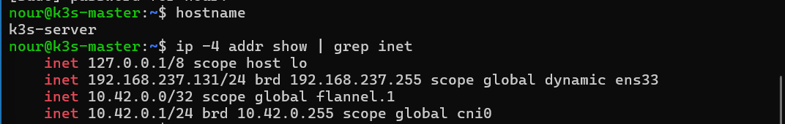

Les captures des agents (étape 4) montrent aussi `hostname`, l'adresse IP et la désactivation du pare-feu :
`k3s-agent1` → 192.168.237.132 et `k3s-agent2` → 192.168.237.133.

### Étape 2 : Installer le serveur

```bash
curl -sfL https://get.k3s.io | sh -
sudo systemctl status k3s --no-pager
sudo k3s kubectl get nodes
```

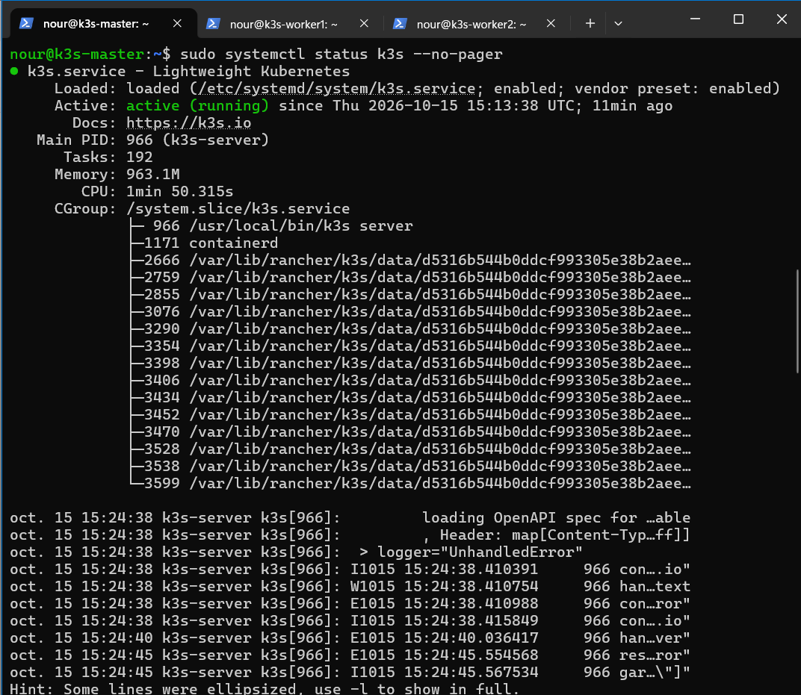

**Point de contrôle**

- [x] Le service `k3s` est `active (running)`
- [x] Un nœud serveur apparaît à l'état `Ready` (voir étape 5)

### Étape 3 : Récupérer le jeton d'adhésion

```bash
sudo cat /var/lib/rancher/k3s/server/node-token
```

Le jeton est un secret : il n'est volontairement pas affiché dans ce compte rendu.

### Étape 4 : Joindre les deux agents

Sur chaque agent (`<IP_SERVEUR>` = 192.168.237.131, `<JETON>` masqué) :

```bash
curl -sfL https://get.k3s.io | K3S_URL=https://<IP_SERVEUR>:6443 K3S_TOKEN=<JETON> sh -
sudo systemctl status k3s-agent --no-pager
```

**k3s-agent1**

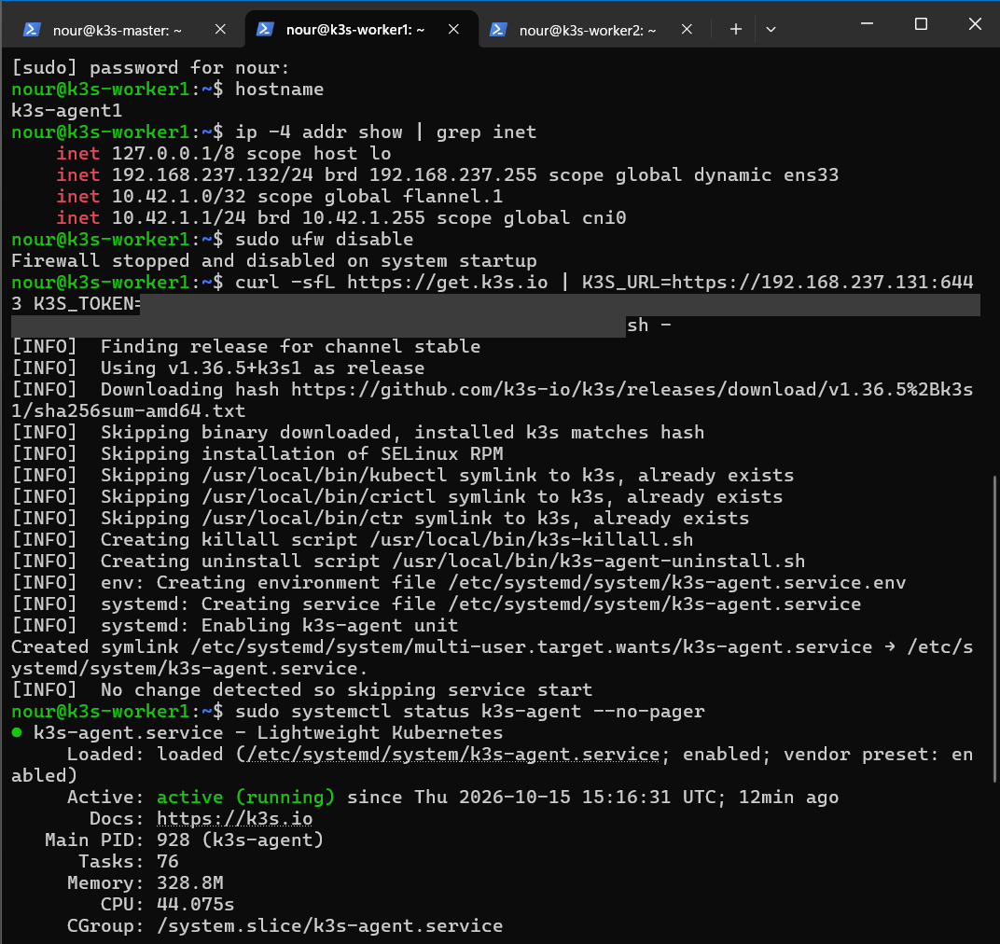

**k3s-agent2**

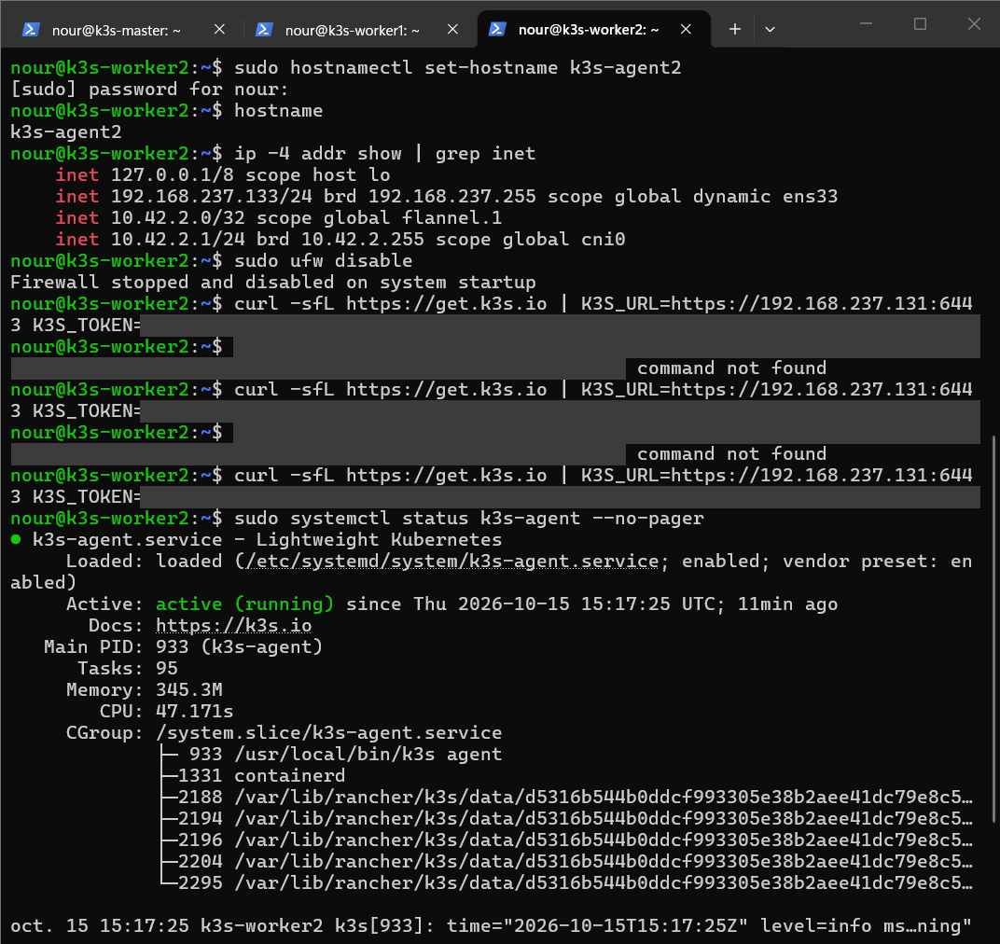

Dans les deux cas, le service `k3s-agent` est `active (running)`.

### Étape 5 : Vérifier le cluster

```bash
sudo k3s kubectl get nodes -o wide
```

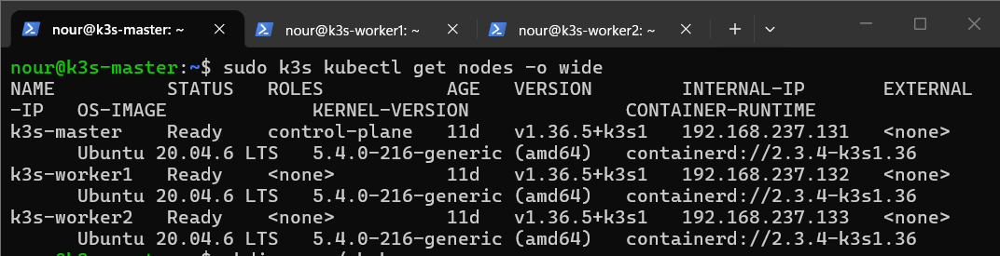

**Point de contrôle**

- [x] Trois nœuds sont à l'état `Ready`
- [x] Les rôles et les adresses IP correspondent au plan : un nœud `control-plane` (192.168.237.131) et deux nœuds sans rôle défini, donc agents (192.168.237.132 et 192.168.237.133)

### Étape 6 : Utiliser kubectl sans sudo

```bash
mkdir -p ~/.kube
sudo cp /etc/rancher/k3s/k3s.yaml ~/.kube/config
sudo chown $USER:$USER ~/.kube/config
chmod 600 ~/.kube/config
kubectl get nodes
```

La capture de l'étape 7 (`kubectl get pods -A -o wide`) est exécutée avec `kubectl` seul, sans `sudo`, ce qui confirme que le kubeconfig est bien en place.

### Étape 7 : Explorer le cluster

```bash
kubectl cluster-info
kubectl get namespaces
kubectl get pods -A -o wide
kubectl get all -n kube-system
sudo ls /var/lib/rancher/k3s/server/manifests/
```

**Tous les Pods du cluster**

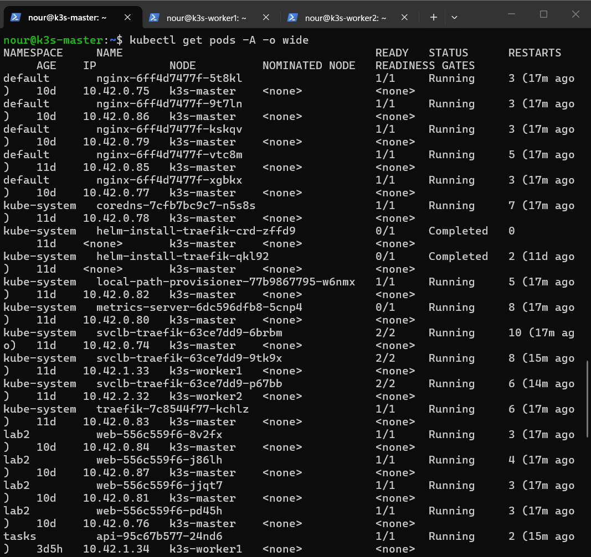

Composants repérés dans `kube-system` :

| Composant | Pod | Nœud |
|---|---|---|
| CoreDNS | `coredns-7cfb7bc9c7-n5s8s` | k3s-master (serveur) |
| Traefik | `traefik-7c8544f77-kchlz` | k3s-master (serveur) |
| ServiceLB pour Traefik | `svclb-traefik-...` (3 Pods, un par nœud) | serveur, worker1, worker2 |
| local-path-provisioner | `local-path-provisioner-77b9867795-w6nmx` | k3s-master (serveur) |
| metrics-server | `metrics-server-6dc596dfb8-5cnp4` | k3s-master (serveur) |
| Jobs d'installation de Traefik | `helm-install-traefik-crd-...` et `helm-install-traefik-...` | `Completed` |

**Manifestes déployés automatiquement par k3s**

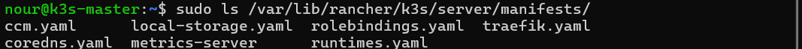

Le dossier contient `ccm.yaml`, `coredns.yaml`, `local-storage.yaml`, `metrics-server`, `rolebindings.yaml`, `runtimes.yaml` et `traefik.yaml`. k3s applique automatiquement tout manifeste placé dans ce dossier.

**Point de contrôle**

- [x] Les Pods de `kube-system` sont `Running` ou `Completed` (les deux Jobs Helm de Traefik sont `Completed`)
- [x] Le Pod Traefik est identifié ; il est exposé par un Service de type `LoadBalancer`, relayé par les Pods `svclb-traefik-*`

> **Remarque :** `metrics-server` est `Running` mais affiche `0/1` dans la colonne `READY` : le Pod tourne, mais il n'est pas déclaré prêt. Cela peut empêcher `kubectl top` de renvoyer des métriques.

Les autres Pods visibles (`default`, `lab2`, `tasks`) viennent d'exercices précédents sur le même cluster.

### Questions de réflexion

**1. Quel composant joue le rôle de Ingress controller dans k3s, et dans quel namespace est-il ?**

C'est **Traefik**, installé par défaut avec k3s dans le namespace **`kube-system`** (Pod `traefik-...`). Il est déployé à l'aide d'un chart Helm (Jobs `helm-install-traefik*`) à partir du manifeste `traefik.yaml` du dossier `manifests`.

**2. Pourquoi le jeton d'adhésion est-il sensible ?**

Toute machine qui connaît le jeton et peut joindre l'API sur le port 6443 peut **rejoindre le cluster comme nœud**. Elle peut alors recevoir des Pods, et donc accéder aux Secrets et aux données de ces Pods. Le jeton ne doit donc jamais être publié (dépôt Git, capture d'écran, etc.).

**3. Où se trouve le datastore du cluster dans cette installation à un seul serveur ?**

Avec un seul serveur, k3s utilise par défaut une base **SQLite** (via l'adaptateur Kine) stockée sur le serveur, dans `/var/lib/rancher/k3s/server/db/`. Il n'y a pas d'etcd dans cette configuration.

---

## Lab 1.2 – Prise en main de kubectl

### Objectifs

- Gagner en vitesse avec l'alias et l'autocomplétion
- Travailler dans un namespace dédié
- Explorer l'API avec `api-resources` et `explain`
- Générer, appliquer et inspecter un manifeste

### Étape 1 : Alias et autocomplétion

```bash
echo 'source <(kubectl completion bash)' >> ~/.bashrc
echo 'alias k=kubectl' >> ~/.bashrc
echo 'complete -o default -F __start_kubectl k' >> ~/.bashrc
source ~/.bashrc
k version
```

L'alias `k` est utilisé dans toutes les captures suivantes (`k get pod web -o wide`, `k config view ...`).

### Étape 2 : Travailler dans votre namespace

```bash
k create namespace tp-k8s
k config get-contexts
k config set-context --current --namespace=tp-k8s
k config view --minify | grep namespace
```

### Étape 3 : Explorer l'API

```bash
k api-resources | head -20
k explain pod
k explain pod.spec.containers
k explain deployment.spec.strategy
```

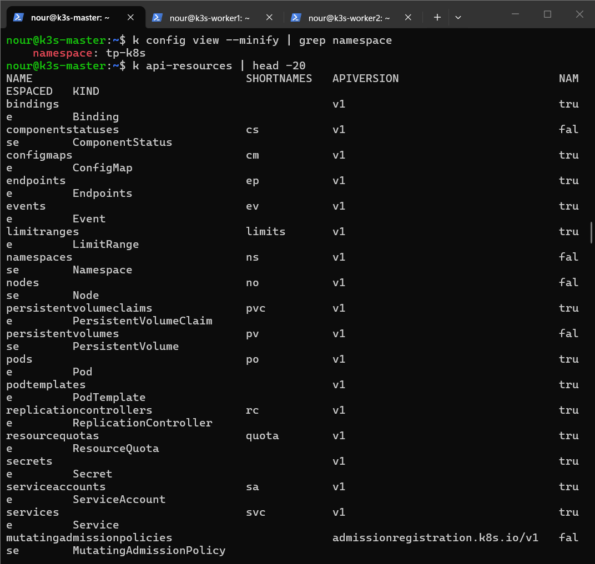

La première commande confirme que le namespace courant est `tp-k8s`. `k api-resources` liste les types de ressources de l'API (nom, abréviation, version, namespacée ou non, kind), par exemple `pods` / `po` / `v1` / `Pod` ou `services` / `svc`.

### Étape 4 : Générer un manifeste sans l'écrire à la main

```bash
k run web --image=nginx:alpine --dry-run=client -o yaml > web.yaml
cat web.yaml
k apply -f web.yaml
k get pod web -o wide
k get pod web -o yaml | head -40
```

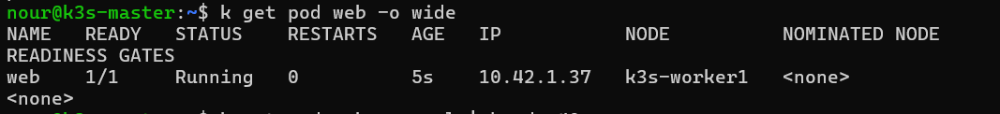

**Point de contrôle**

- [x] Le Pod `web` est `Running` (`1/1`, 0 redémarrage)
- [x] Il s'exécute sur le nœud **k3s-worker1**, avec l'IP de Pod `10.42.1.37`

### Étape 5 : Inspecter un Pod

```bash
k describe pod web
k logs web
k exec -it web -- sh
# dans le conteneur : hostname, wget -qO- localhost, exit
```

Section `Events` de `k describe pod web` :

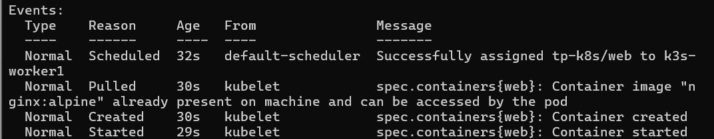

Les événements racontent le démarrage du Pod, dans l'ordre :

1. `Scheduled` : le scheduler a assigné `tp-k8s/web` au nœud `k3s-worker1`
2. `Pulled` : l'image `nginx:alpine` était déjà présente sur la machine
3. `Created` : le conteneur a été créé
4. `Started` : le conteneur a démarré

### Étape 6 : Extraire des informations précises

```bash
k get pod web -o jsonpath='{.status.podIP}'; echo
k get pods -o custom-columns=NOM:.metadata.name,NOEUD:.spec.nodeName,IP:.status.podIP
```

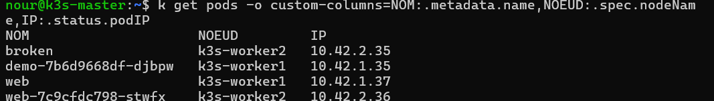

`custom-columns` affiche uniquement le nom, le nœud et l'IP de chaque Pod du namespace. On retrouve `web` sur `k3s-worker1` avec l'IP `10.42.1.37`, comme à l'étape 4.

### Étape 7 : Modifier puis recréer

```bash
k label pod web tier=frontend
k get pods --show-labels
k delete -f web.yaml
k get pods
```

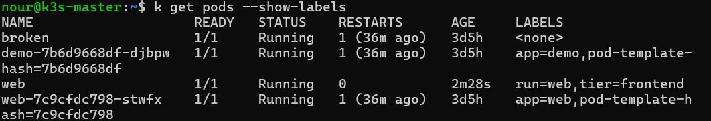

Le Pod `web` porte maintenant deux labels : `run=web` (ajouté par `kubectl run`) et `tier=frontend` (ajouté à la main).

### Questions de réflexion

**1. Quelle différence entre `kubectl create` et `kubectl apply` ?**

`kubectl create` est **impératif** : il crée l'objet et échoue s'il existe déjà. `kubectl apply` est **déclaratif** : il crée l'objet s'il n'existe pas, ou le met à jour pour qu'il corresponde au fichier. On peut le relancer autant de fois que nécessaire, ce qui le rend adapté à un fichier suivi dans Git.

**2. À quoi sert `--dry-run=client -o yaml` ?**

À **générer le manifeste YAML sans rien créer** dans le cluster : `kubectl` construit l'objet localement, l'affiche au format YAML et ne l'envoie pas à l'API. C'est un moyen rapide d'obtenir un squelette (`apiVersion`, `kind`, `metadata`, `spec`) à modifier, au lieu de l'écrire à la main.

**3. Où trouver la raison d'un Pod qui ne démarre pas ?**

Dans la section **`Events`** de `kubectl describe pod <nom>` (planification, téléchargement de l'image, erreurs de démarrage). On complète avec `kubectl logs <pod>` (et `--previous` après un redémarrage) pour lire la sortie du conteneur.

### Nettoyage

```bash
k delete namespace tp-k8s
k config set-context --current --namespace=default
```

---

## Lab 2.1 – Mon premier Pod

### Objectifs

- Écrire à la main le manifeste d'un Pod et l'appliquer
- Observer le cycle de vie d'un Pod isolé (il n'est pas recréé après suppression, son IP change)
- Provoquer et lire `ImagePullBackOff` et `CrashLoopBackOff`
- Comparer `restartPolicy` et les phases d'un Pod
- Utiliser les labels et les sélecteurs

> **Remarque sur le namespace.** Le namespace `tp-k8s` était resté bloqué à l'état `Terminating` (l'APIService de `metrics-server` ne répondait pas, ce qui empêche Kubernetes de finir la suppression). La création d'un Pod y est donc refusée. Ce lab a été réalisé dans le namespace **`tp-k8s2`**, ce qui explique que les messages des captures mentionnent `tp-k8s2`.

### Préparation et manifeste du Pod

```bash
mkdir -p ~/lab2 && cd ~/lab2
k create namespace tp-k8s
k config set-context --current --namespace=tp-k8s
cat <<'EOF' > web.yaml
apiVersion: v1
kind: Pod
metadata:
  name: web
  labels:
    app: web
    tier: frontend
spec:
  containers:
    - name: web
      image: nginx:1.26-alpine
      ports:
        - containerPort: 80
EOF
k apply -f web.yaml
```

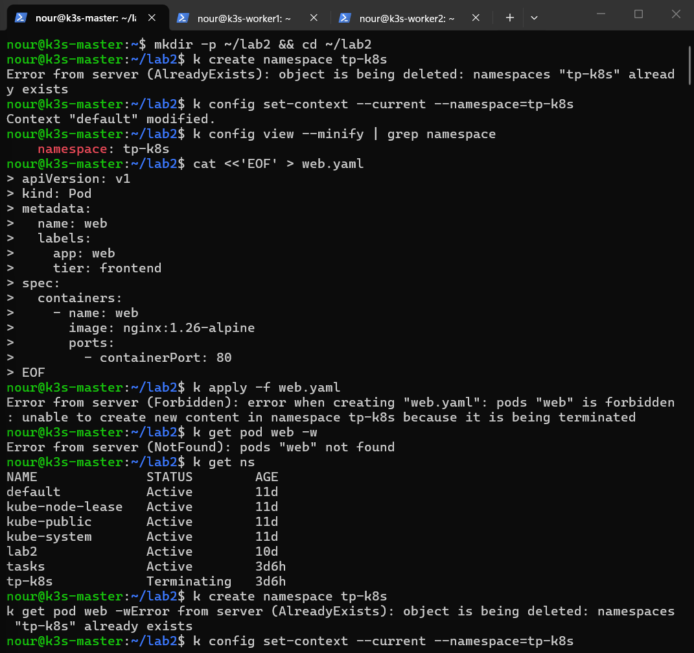

La capture montre le problème décrit ci-dessus : `k create namespace` répond `AlreadyExists: object is being deleted`, et `k apply` est refusé (`unable to create new content in namespace tp-k8s because it is being terminated`). `k get ns` confirme que `tp-k8s` est en `Terminating`. Le manifeste du Pod `web` porte deux labels (`app: web` et `tier: frontend`).

### Pod en fonctionnement : IP et accès par le réseau du cluster

```bash
k get pod web -o wide
IP=$(k get pod web -o jsonpath='{.status.podIP}')
echo $IP
k run test --rm -it --image=busybox:1.36 --restart=Never -- wget -qO- http://$IP
```

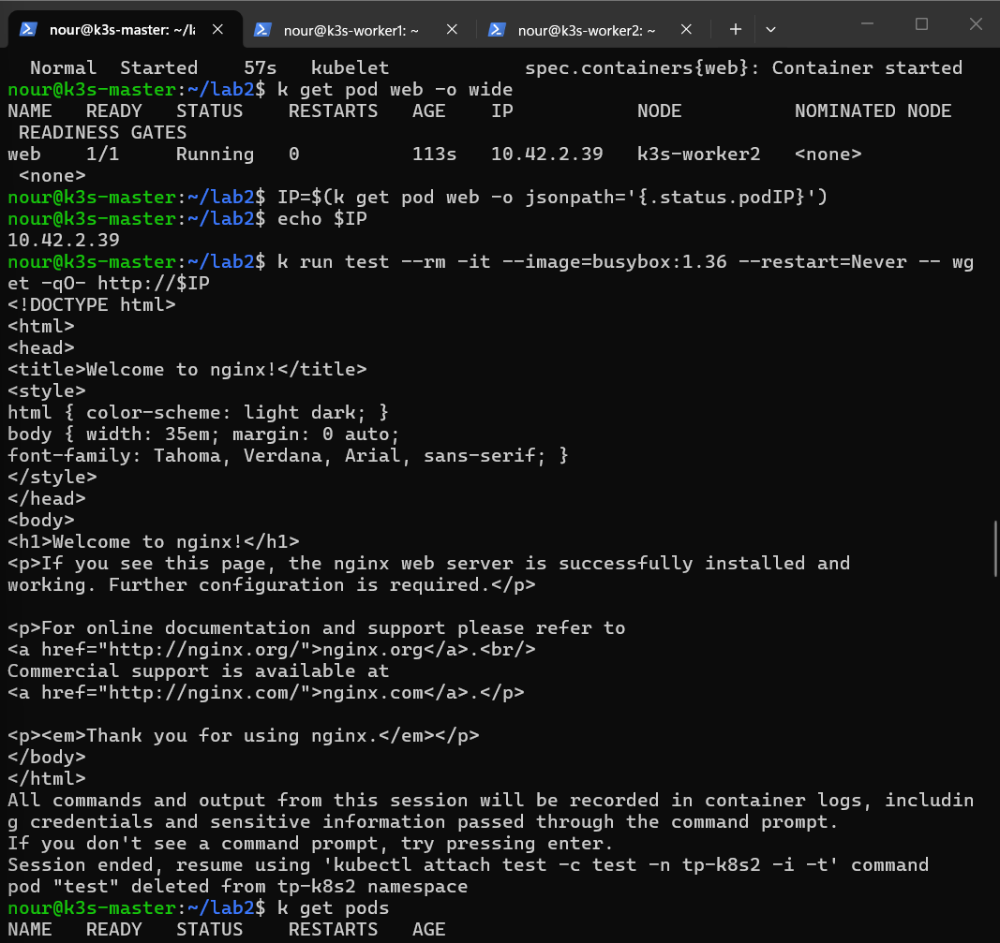

Le Pod `web` est `Running` (`1/1`, 0 redémarrage) sur le nœud `k3s-worker2` avec l'IP `10.42.2.39`. Depuis un Pod temporaire `busybox`, `wget` sur cette IP renvoie la page « Welcome to nginx! » : un Pod est joignable directement par son adresse dans le cluster.

### Labels, sélecteurs, restartPolicy et phases

```bash
k get pods -l tier=frontend
k delete pods -l app=web
k get pods
```

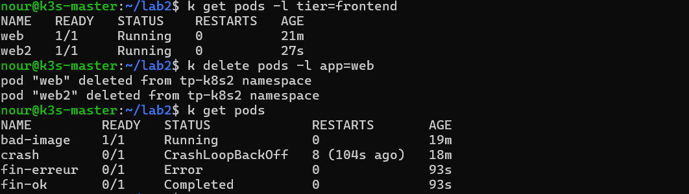

- `k get pods -l tier=frontend` sélectionne **deux Pods** (`web` et `web2`) : le sélecteur filtre sur le label, pas sur le nom.
- `k delete pods -l app=web` supprime les deux d'un coup, car ils portent tous les deux `app=web`.
- Les Pods restants illustrent les états étudiés dans le lab :

| Pod | État | Ce que cela montre |
|---|---|---|
| `bad-image` | `Running` | Pod de l'exercice sur l'image incorrecte, ici revenu à l'état sain |
| `crash` | `CrashLoopBackOff`, 8 redémarrages | Le conteneur s'arrête en erreur et Kubernetes le relance avec un délai croissant |
| `fin-erreur` | `Error` | Conteneur terminé avec un code d'erreur (`restartPolicy: Never`) |
| `fin-ok` | `Completed` | Conteneur terminé normalement (`restartPolicy: Never`) |

### Nettoyage

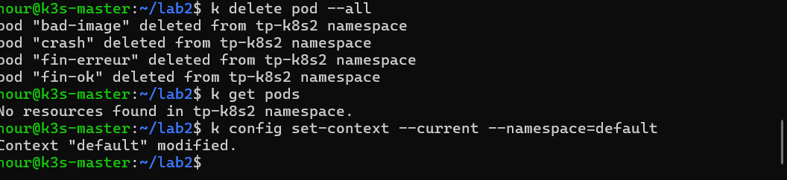

`k delete pod --all` supprime les quatre Pods, puis le contexte est remis sur le namespace `default`.

---

## Lab 2.2 – Deployments et mises à jour

### Objectifs

- Déployer une application avec un Deployment et lire la chaîne Deployment → ReplicaSet → Pods
- Observer l'auto-réparation et changer le nombre de réplicas
- Réaliser une mise à jour progressive, puis un retour arrière
- Diagnostiquer une mise à jour qui échoue
- Comprendre le rôle du sélecteur et des labels

### Étape 1 : Préparer le namespace

```bash
k create namespace tp-k8s
k config set-context --current --namespace=tp-k8s
k get all
```

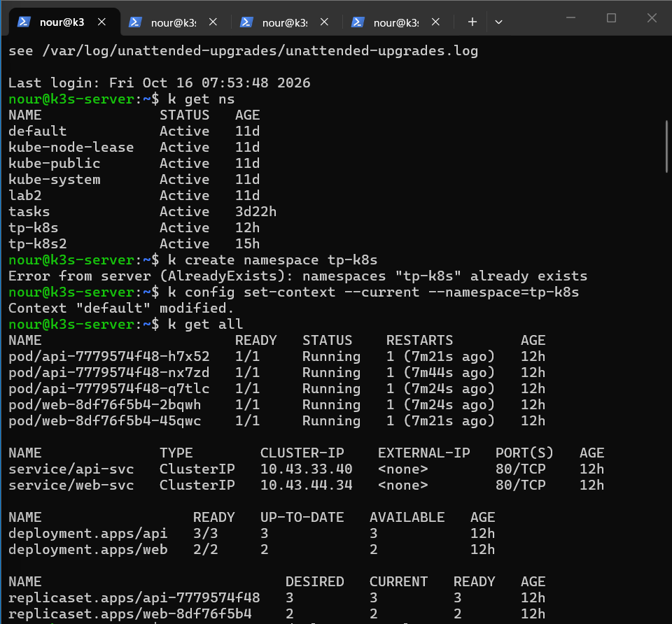

Le namespace `tp-k8s` existe déjà (`AlreadyExists`). Il contient des ressources d'exercices précédents : les Deployments `api` (3 Pods) et `web` (2 Pods) avec leurs Services `api-svc` et `web-svc`. Le Deployment `web` est celui que ce lab fait évoluer.

### Étape 2 : Créer un Deployment

```bash
k apply -f deployment.yaml
k get deployment,replicaset,pods -o wide
k describe deployment web
```

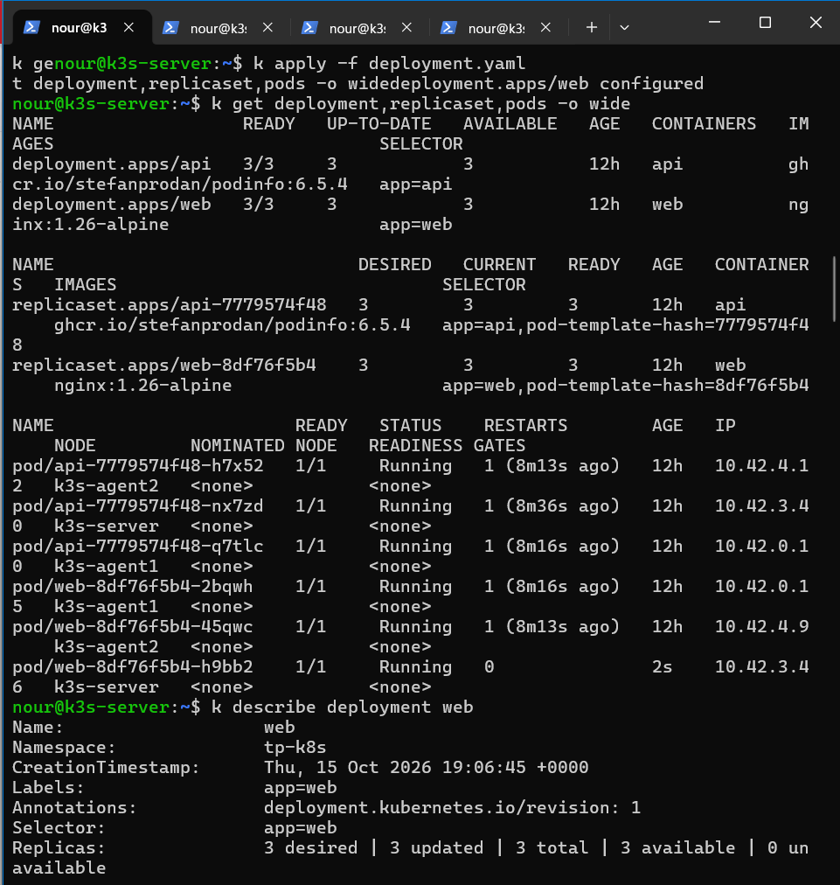

**Point de contrôle**

- [x] `web` est à `3/3`, avec un seul ReplicaSet `web-8df76f5b4` pour l'image `nginx:1.26-alpine`
- [x] Le hash du ReplicaSet (`8df76f5b4`) se retrouve dans le nom des Pods (`web-8df76f5b4-...`)
- [x] `describe` indique `Replicas: 3 desired | 3 updated | 3 total | 3 available` et la révision `1`

La commande `apply` répond `deployment.apps/web configured` : le Deployment existait avec 2 réplicas, le fichier en demande 3, et un troisième Pod (`web-8df76f5b4-h9bb2`, âgé de 2 s) vient d'être créé.

### Étape 3 : Observer l'auto-réparation

```bash
k get pods -w                 # second terminal
POD=$(k get pods -l app=web -o jsonpath='{.items[0].metadata.name}')
echo $POD
k delete pod $POD
```

Suppression du Pod :

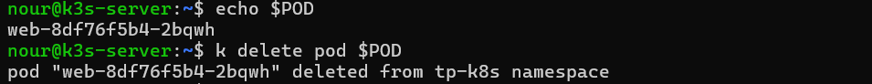

Surveillance dans le second terminal :

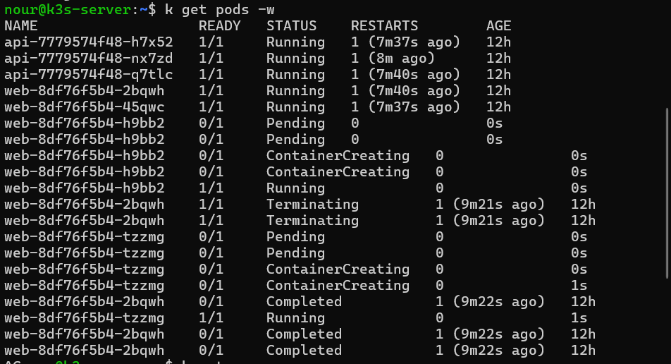

Dès la suppression de `web-8df76f5b4-2bqwh` (`Terminating`), le ReplicaSet crée un remplaçant avec un autre suffixe, `web-8df76f5b4-tzzmg`, qui passe par `Pending`, `ContainerCreating` puis `Running`. Le Deployment revient à 3/3.

### Étapes 4 à 6 : réplicas, mise à jour et retour arrière

Les commandes de ces étapes sont celles de l'énoncé (`k scale`, `sed` sur l'image, `k rollout status`, `k rollout history`, `k rollout undo`). Le retour arrière de l'étape 7 est visible sur la capture suivante.

### Étape 7 : Mise à jour qui échoue, puis retour arrière

```bash
k rollout undo deployment/web
k rollout status deployment/web
k get pods
```

### Étape 8 : Labels, sélecteur et Pods orphelins

```bash
k get pods --show-labels
POD=$(k get pods -l app=web -o jsonpath='{.items[0].metadata.name}')
k label pod $POD app=autre --overwrite
k get pods --show-labels
```

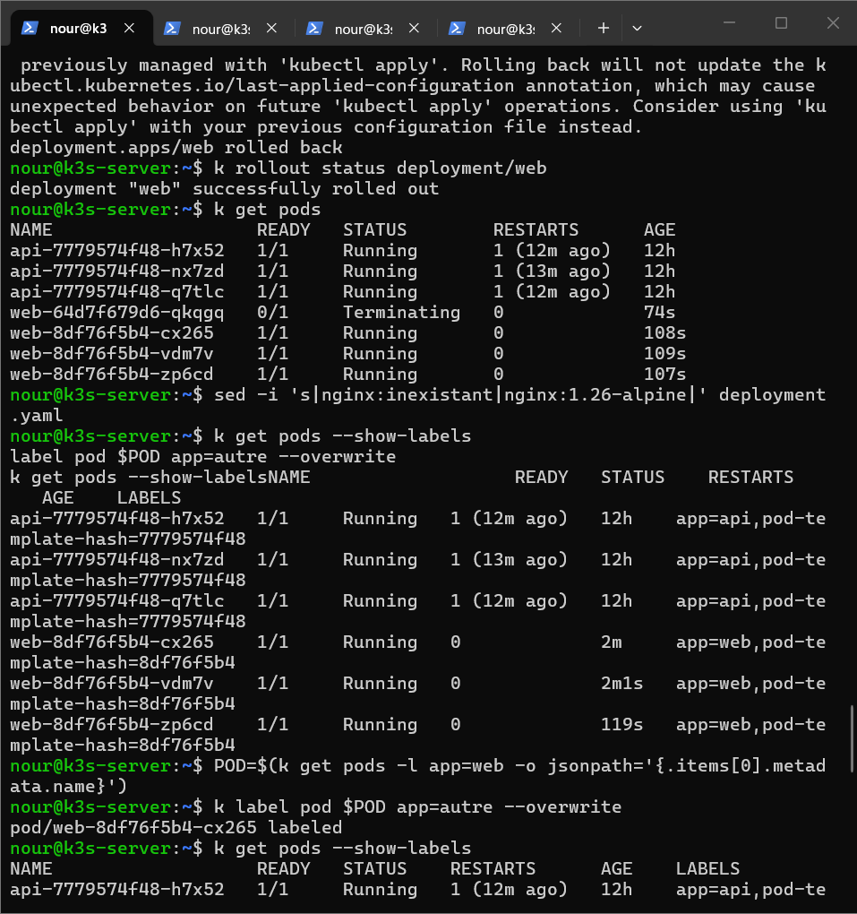

- `k rollout undo` répond `deployment.apps/web rolled back` (avec l'avertissement habituel sur l'annotation `last-applied-configuration`), puis `k rollout status` indique `successfully rolled out`.
- Dans `k get pods`, le Pod `web-64d7f679d6-...` de la mise à jour échouée passe en `Terminating`, et les trois Pods `web-8df76f5b4-...` de la version saine sont `Running`.
- Le label du Pod `web-8df76f5b4-cx265` est changé en `app=autre` : il sort du périmètre du Deployment.

Suite de l'étape 8 et exercice facultatif :

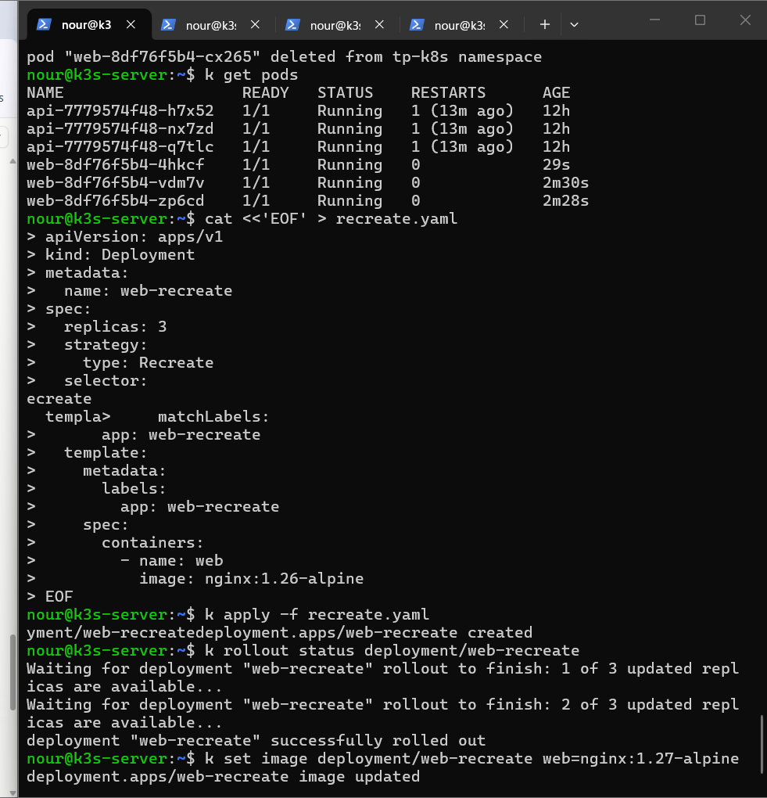

Après `k delete pod web-8df76f5b4-cx265`, il reste trois Pods `web` : deux anciens (`vdm7v` et `zp6cd`) et `4hkcf`, créé 29 s plus tôt pour remplacer le Pod sorti du périmètre. En bas de la capture, le Deployment `web-recreate` (`strategy: Recreate`) est créé, puis son image est changée avec `k set image ... web=nginx:1.27-alpine`.

**Point de contrôle**

- [x] Après `rollout undo`, tous les Pods `web` sont `Running` et le Pod de l'ancienne tentative disparaît
- [x] Le Pod modifié n'est plus géré : un remplaçant a été créé et le Pod orphelin a été supprimé à la main
- [x] Il reste trois Pods `web` gérés par le Deployment

### Questions de réflexion

**1. Combien de ReplicaSets existent après deux mises à jour successives, et pourquoi les anciens sont-ils conservés ?**

Un ReplicaSet par version du modèle de Pod, dans la limite de l'historique conservé. Les anciens sont ramenés à 0 Pod mais gardés pour permettre un retour arrière sans tout recréer.

**2. Pourquoi les anciens Pods sont-ils restés `Running` pendant la mise à jour échouée ?**

Avec 3 réplicas et les valeurs par défaut (25 % d'indisponibilité maximale), le Deployment ne retire un ancien Pod que lorsqu'un nouveau est disponible. Le nouveau Pod restait en erreur, donc la mise à jour est restée bloquée, mais le service est resté assuré par les anciens Pods.

**3. Quelle différence entre `kubectl scale` et la modification de `replicas` dans le fichier ?**

`scale` agit directement sur le cluster et laisse le fichier inchangé, ce qui crée un écart. Modifier le fichier puis faire `apply` garde le fichier comme source de vérité, reproductible et versionnable.

**4. Après `rollout undo`, que se passe-t-il si on réapplique `deployment.yaml` sans le corriger ?**

Le fichier indique encore l'ancienne version : `apply` la redéploie et annule le retour arrière. Le fichier doit donc toujours refléter l'état voulu.

**5. Pourquoi le Pod dont on a changé le label n'a-t-il pas été supprimé par le Deployment ?**

Le ReplicaSet ne gère que les Pods qui correspondent à son sélecteur. Un Pod qui n'y correspond plus est ignoré, et un remplaçant est créé pour retrouver le nombre de réplicas voulu.

---

## Lab 3.1 – Exposer une application

### Objectifs

- Exposer un Deployment par un Service `ClusterIP` et vérifier ses endpoints
- Joindre un Service par son nom DNS, y compris depuis un autre namespace
- Observer la répartition de charge entre les Pods
- Exposer une application hors du cluster avec `NodePort` puis `LoadBalancer` (ServiceLB)

> **Remarque sur le namespace.** `tp-k8s` étant encore en `Terminating` à ce moment-là (visible sur la première capture), ce lab a été réalisé dans le namespace **`tp-k8s3`**. C'est pourquoi le nom qualifié du Service est `podinfo-svc.tp-k8s3` à l'étape 9, au lieu de `podinfo-svc.tp-k8s`.

### Étape 1 : Préparer le namespace et déployer l'application

```bash
k create namespace tp-k8s3
k config set-context --current --namespace=tp-k8s3
k apply -f podinfo.yaml
k get pods -o wide
```

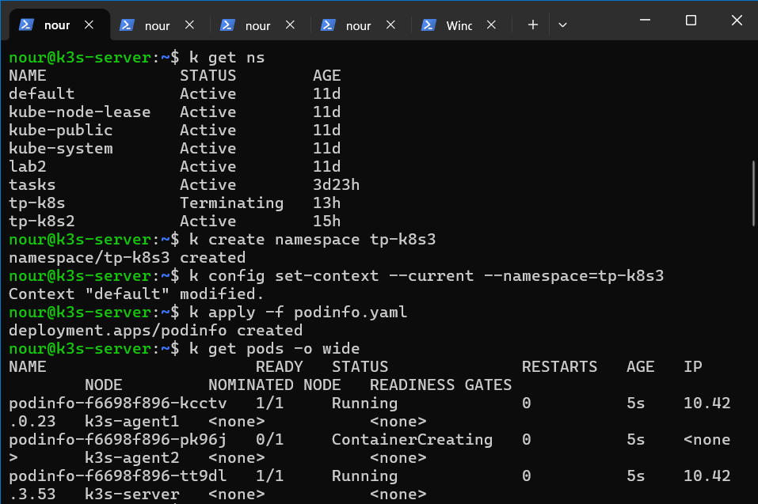

`k get ns` montre `tp-k8s` en `Terminating` et `tp-k8s2` actif. Le Deployment `podinfo` crée trois Pods, répartis sur les trois nœuds : `k3s-agent1` (IP `10.42.0.23`), `k3s-agent2` (en cours de création) et `k3s-server` (IP `10.42.3.53`).

**Point de contrôle**

- [x] Trois Pods `podinfo` sont créés, un par nœud
- [x] Leurs adresses IP sont relevées : `10.42.0.23`, `10.42.3.53` et `10.42.4.21` (cette dernière apparaît dans la capture suivante)

### Étape 2 : Créer un Service ClusterIP

```bash
k apply -f podinfo-svc.yaml
k get service podinfo-svc
k get endpoints podinfo-svc
```

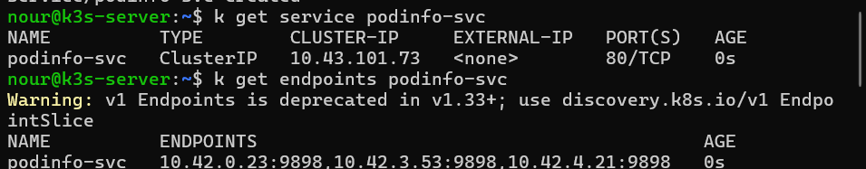

**Point de contrôle**

- [x] `podinfo-svc` a une `CLUSTER-IP` (`10.43.101.73`) et aucune `EXTERNAL-IP`
- [x] Les endpoints (`10.42.0.23:9898`, `10.42.3.53:9898`, `10.42.4.21:9898`) correspondent aux trois adresses des Pods

### Étape 4 : Observer la répartition de charge

```bash
k run test --rm -it --image=busybox:1.36 --restart=Never -- \
  sh -c 'sleep 3; for i in 1 2 3 4 5 6 7 8 9 10; do wget -qO- http://podinfo-svc | grep hostname; done'
```

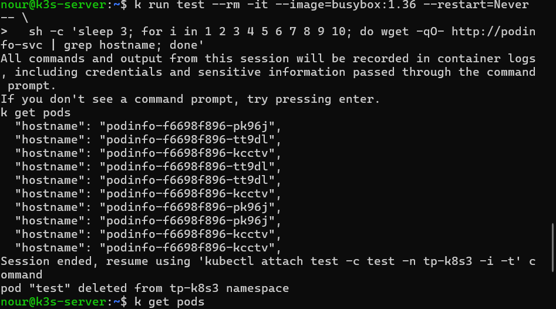

Dix requêtes successives sont envoyées au Service. Les réponses viennent de **trois Pods différents** (`podinfo-f6698f896-pk96j`, `-tt9dl` et `-kcctv`), ce qui montre que le Service répartit les requêtes entre les Pods.

### Étape 5 : Suivre les Pods avec les endpoints

```bash
k get endpoints podinfo-svc -w      # second terminal
k scale deployment podinfo --replicas=5
k delete pod $POD
k scale deployment podinfo --replicas=3
```

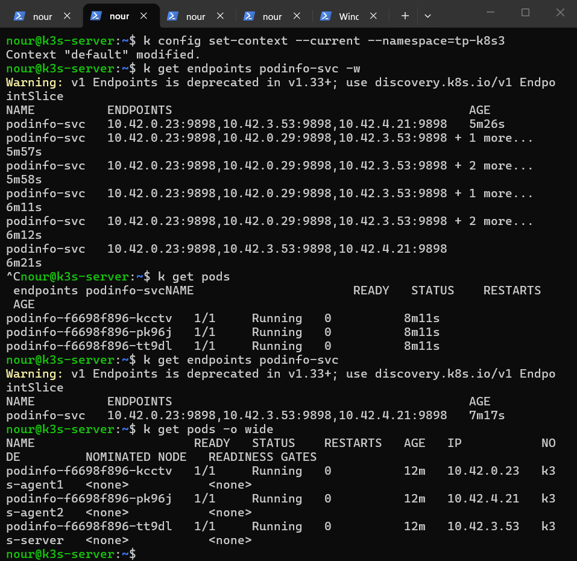

Dans le second terminal, la liste des endpoints suit les Pods : elle passe de trois adresses à quatre (`+ 1 more...`), puis cinq (`+ 2 more...`) avec 5 réplicas, évolue quand un Pod est supprimé, puis revient aux trois adresses `10.42.0.23`, `10.42.3.53` et `10.42.4.21` après le retour à 3 réplicas. Les endpoints se mettent à jour automatiquement.

### Étape 7 : Exposer hors du cluster avec NodePort

```bash
k apply -f podinfo-nodeport.yaml
k get service podinfo-nodeport
```

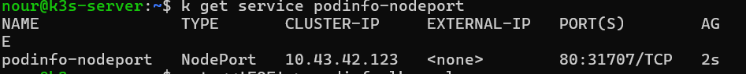

Le Service `podinfo-nodeport` est de type `NodePort` : il écoute sur le port `80` à l'intérieur du cluster et sur le **port `31707`** de chaque nœud (`80:31707/TCP`).

### Étape 8 : Exposer avec LoadBalancer (ServiceLB)

```bash
k apply -f podinfo-lb.yaml
k get service podinfo-lb
k get pods -n kube-system | grep svclb
```

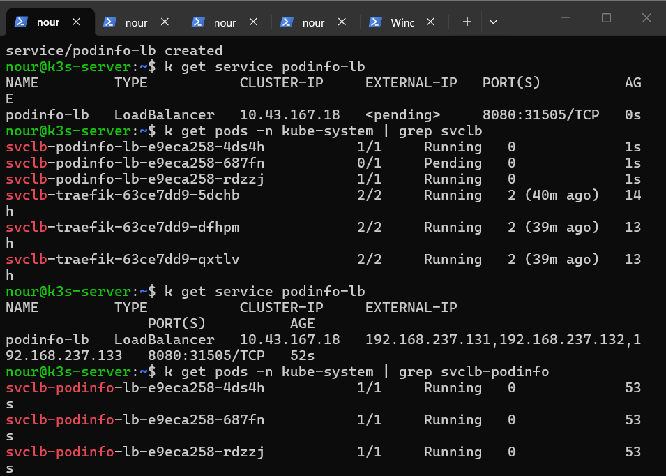

- Juste après la création, `EXTERNAL-IP` est `<pending>` et les Pods `svclb-podinfo-lb-...` démarrent (un est encore `Pending`).
- Quelques secondes plus tard, `EXTERNAL-IP` affiche les trois adresses des nœuds (`192.168.237.131,192.168.237.132,192.168.237.133`) et les trois Pods `svclb-podinfo-lb-...` sont `Running`, à côté des Pods `svclb-traefik-...`.
- Le Service écoute sur le port `8080` (`8080:31505/TCP`) : les ports 80 et 443 sont déjà utilisés par Traefik.

**Point de contrôle**

- [x] `EXTERNAL-IP` n'est plus `<pending>`
- [x] Les Pods `svclb` du Service `podinfo-lb` sont identifiés dans `kube-system`

### Étape 9 : Joindre un Service depuis un autre namespace

```bash
k create namespace tp-autre
k run test -n tp-autre --rm -it --image=busybox:1.36 --restart=Never -- wget -T 3 -qO- http://podinfo-svc
k run test -n tp-autre --rm -it --image=busybox:1.36 --restart=Never -- wget -qO- http://podinfo-svc.tp-k8s3
```

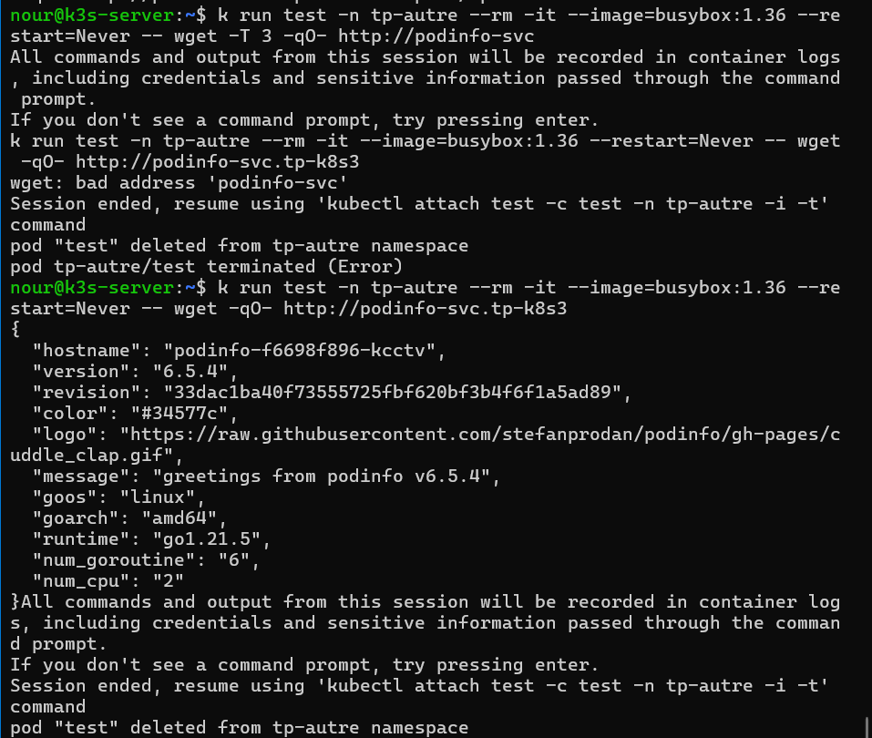

**Point de contrôle**

- [x] Le nom court échoue depuis `tp-autre` : `wget: bad address 'podinfo-svc'`
- [x] Le nom qualifié `podinfo-svc.tp-k8s3` répond avec le JSON de podinfo (`version 6.5.4`)

### Questions de réflexion

**1. Quelle est la différence entre `port` et `targetPort` dans un Service ?**

`port` est le port sur lequel le Service écoute ; `targetPort` est le port du conteneur vers lequel le trafic est transmis. Ici, `80` vers `9898`.

**2. Pourquoi l'application répond-elle sur l'adresse d'un nœud qui n'héberge aucun Pod ?**

Un `NodePort` est ouvert sur tous les nœuds : `kube-proxy` transmet le trafic vers un Pod du Service, quel que soit le nœud qui l'héberge.

**3. Qu'est-ce qu'une liste d'endpoints vide vous apprend ?**

Aucun Pod prêt ne correspond au sélecteur du Service : sélecteur erroné, labels différents, ou Pods absents ou en erreur. C'est le premier contrôle à faire quand un Service ne répond pas.

**4. Pourquoi ne pas exposer toutes les applications web avec un NodePort ?**

Chaque application consomme un port élevé distinct, difficile à gérer et à sécuriser, sans routage par nom d'hôte ni point d'entrée unique. C'est l'objet du Lab 3.2 (Ingress).

**5. Qu'est-ce qui distingue ClusterIP, NodePort et LoadBalancer ?**

`ClusterIP` : adresse interne uniquement. `NodePort` : ouvre en plus un port sur chaque nœud. `LoadBalancer` : ajoute une adresse externe (ici, les IP des nœuds via ServiceLB).

---

## Lab 3.2 – Ingress avec Traefik

### Objectifs

- Repérer l'Ingress controller (Traefik) fourni par k3s
- Exposer deux applications derrière un point d'entrée unique, par nom d'hôte
- Router par chemin vers deux Services différents
- Distinguer une erreur de routage d'une erreur de l'application

### Étape 1 : Déployer les deux applications

```bash
k create namespace tp-k8s
k config set-context --current --namespace=tp-k8s
k apply -f apps.yaml
k get deployments,services
k get endpoints
```

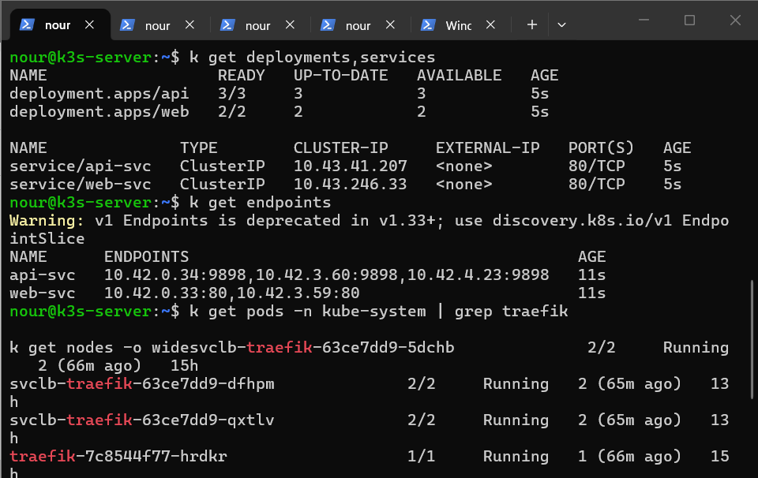

**Point de contrôle**

- [x] `api` est à `3/3` et `web` à `2/2`, soit 5 Pods
- [x] `web-svc` a 2 endpoints (`10.42.0.33:80`, `10.42.3.59:80`) et `api-svc` en a 3 (`10.42.0.34`, `10.42.3.60`, `10.42.4.23`, port `9898`)

### Étape 2 : Repérer Traefik

```bash
k get pods -n kube-system | grep traefik
k get service traefik -n kube-system
k get ingressclass
k get nodes -o wide
```

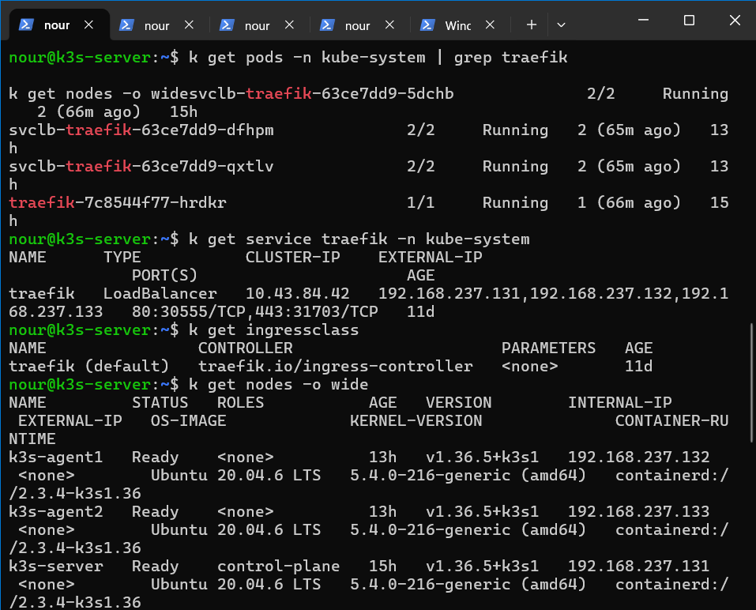

**Point de contrôle**

- [x] Le Pod `traefik-7c8544f77-hrdkr` est `Running` (avec les Pods `svclb-traefik-...` sur les trois nœuds)
- [x] Le Service `traefik` est de type `LoadBalancer`, avec les ports `80:30555/TCP` et `443:31703/TCP`, et les trois IP de nœuds en `EXTERNAL-IP`
- [x] L'IngressClass est `traefik` (par défaut), avec le contrôleur `traefik.io/ingress-controller`
- [x] Les nœuds sont `k3s-server` (`192.168.237.131`), `k3s-agent1` (`192.168.237.132`) et `k3s-agent2` (`192.168.237.133`)

### Étape 3 : Créer un Ingress par nom d'hôte

```bash
k apply -f ingress-hotes.yaml
k get ingress
k describe ingress apps-ingress
```

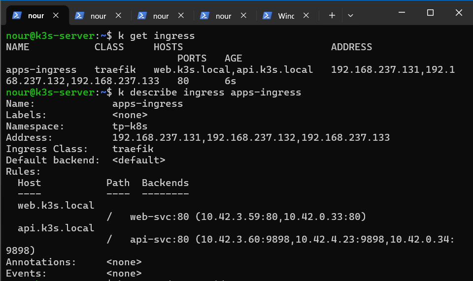

**Point de contrôle**

- [x] L'Ingress `apps-ingress` existe avec les hôtes `web.k3s.local` et `api.k3s.local`, la classe `traefik` et le port `80`
- [x] `describe` affiche `web-svc:80` avec ses deux endpoints et `api-svc:80` avec ses trois endpoints

### Étape 5 : Utiliser de vrais noms d'hôte

Après l'ajout de `web.k3s.local api.k3s.local site.k3s.local` au fichier `hosts` de Windows :

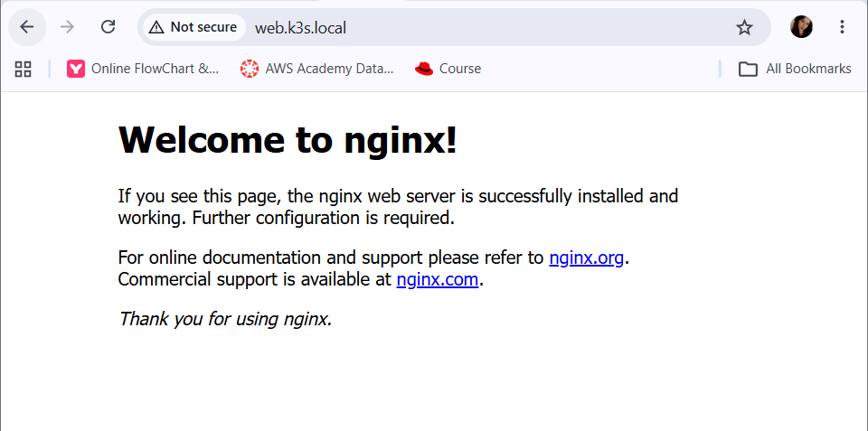

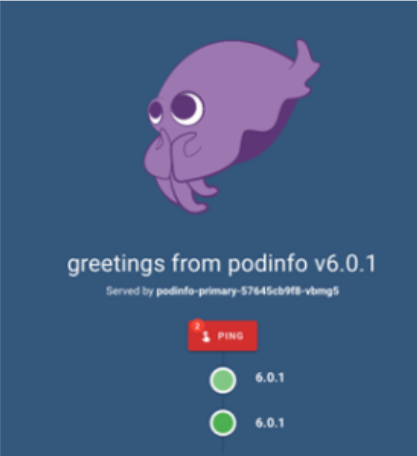

Le navigateur affiche la page d'accueil de nginx sur `web.k3s.local` et la page de l'API (podinfo) sur `api.k3s.local`, sur la même adresse et le même port 80.

### Étape 6 : Router par chemin

```bash
k apply -f ingress-chemins.yaml
k get ingress
```

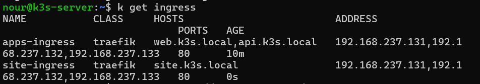

Un second Ingress, `site-ingress`, apparaît pour l'hôte `site.k3s.local`, avec les mêmes adresses et le port `80`. Le chemin `/version` est envoyé à `api-svc`, tous les autres chemins à `web-svc`.

### Étape 7 : Distinguer les erreurs

```bash
curl.exe -i -H "Host: inconnu.k3s.local" http://192.168.237.131
curl.exe -i http://web.k3s.local/nexiste-pas
```

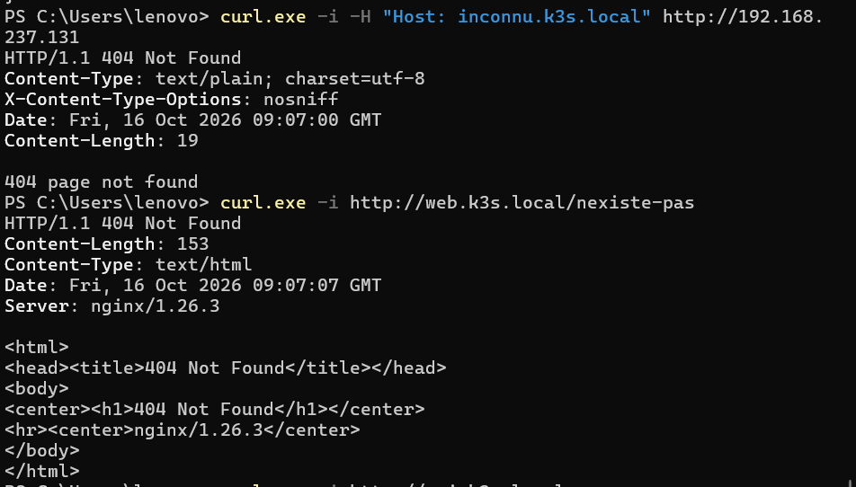

| Cas | Réponse | Origine |
|---|---|---|
| a) Hôte inconnu de l'Ingress | `404 Not Found`, `Content-Type: text/plain`, corps `404 page not found` (19 octets) | **Traefik** : aucune règle ne correspond |
| b) Chemin inexistant dans nginx | `404 Not Found`, `Content-Type: text/html`, page HTML signée `nginx/1.26.3` | **nginx** : la règle a fonctionné, mais la page n'existe pas |

Le cas c) (Service sans Pod, après `k scale deployment api --replicas=0`) n'est pas visible sur cette capture. D'après l'énoncé, la règle existe mais le Service n'a plus d'endpoint : la réponse attendue est un `503 Service Unavailable`.

### Questions de réflexion

**1. Pourquoi préfère-t-on un Ingress à deux Services de type NodePort pour des applications web ?**

L'Ingress offre un point d'entrée unique (ports 80 et 443) avec des noms d'hôte lisibles et du routage par chemin. Les NodePort multiplient les ports élevés, sans routage par nom ni par chemin.

**2. Quel est le rôle de l'objet Ingress, et celui de Traefik ?**

L'Ingress décrit les règles de routage. Traefik, l'Ingress controller, les lit et route réellement le trafic. Sans controller, l'Ingress n'a aucun effet.

**3. Pourquoi l'application répond-elle sur l'adresse de n'importe quel nœud ?**

Traefik est exposé par un Service `LoadBalancer` (ServiceLB), qui ouvre les ports 80 et 443 sur chaque nœud.

**4. Une règle `/version` et une règle `/` existent pour le même hôte. Laquelle s'applique à `/version` ?**

La règle `/version`, car la correspondance la plus spécifique (le préfixe le plus long) l'emporte.

**5. Comment reconnaître qu'une réponse 404 vient de Traefik plutôt que de l'application ?**

Au contenu : celui de Traefik est un message court en texte brut (`404 page not found`), celui de nginx est une page HTML. Si l'erreur vient de Traefik, aucune règle n'a correspondu : vérifier l'hôte, le chemin et l'Ingress.

---

# Partie 2 – Configuration, données et sécurité

## Lab 4.1 – Externaliser la configuration

### Objectifs

- Créer un ConfigMap et un Secret, en YAML et en ligne de commande
- Les injecter dans un Pod par variables d'environnement et par fichiers
- Constater quand une modification est (ou n'est pas) prise en compte
- Monter un fichier de configuration dans un conteneur nginx
- Diagnostiquer un Pod qui référence une configuration inexistante

> **Remarque sur le namespace.** Ce lab a été réalisé dans le namespace **`tp-k8s4`** (au lieu de `tp-k8s`), comme les captures le montrent. Les mots de passe affichés (`ChangeMe-123`) sont les valeurs fictives fournies par l'énoncé.

### Étapes 1 et 2 : Préparer le namespace et créer le ConfigMap

```bash
k create namespace tp-k8s4
k config set-context --current --namespace=tp-k8s4
k apply -f app-config.yaml
k get configmap app-config
k describe configmap app-config
```

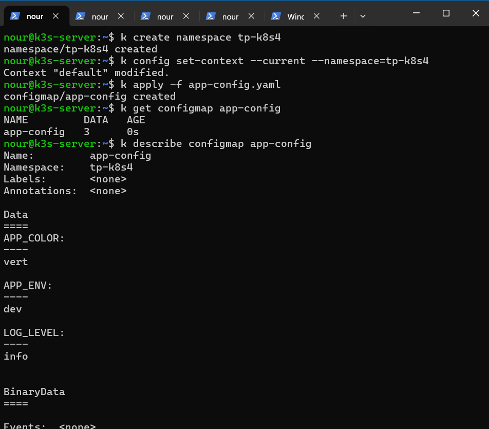

Dans cette capture, le fichier `app-config.yaml` contenait déjà la valeur modifiée plus tard (`APP_COLOR: vert`) ; `k get configmap` indique 3 clés (`DATA 3`).

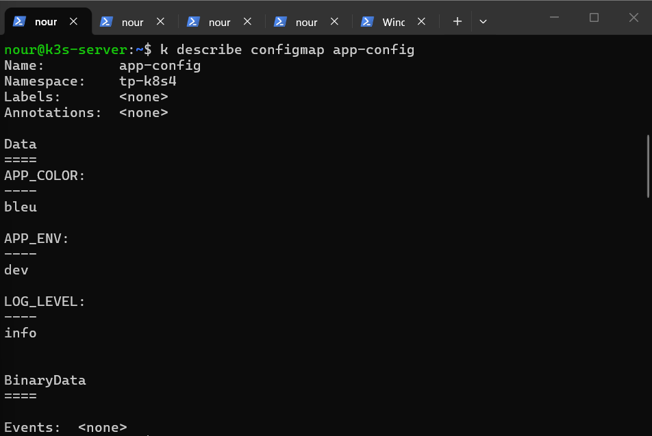

**Point de contrôle**

- [x] Le ConfigMap `app-config` contient 3 clés : `APP_COLOR` (`bleu`), `APP_ENV` (`dev`) et `LOG_LEVEL` (`info`)
- [x] Les trois valeurs sont lisibles en clair dans `describe`

### Étape 3 : Créer un Secret

```bash
k create secret generic db-credentials --from-literal=DB_USER=appuser --from-literal=DB_PASSWORD='ChangeMe-123'
k describe secret db-credentials
k get secret db-credentials -o yaml
k get secret db-credentials -o jsonpath='{.data.DB_PASSWORD}' | base64 -d; echo
```

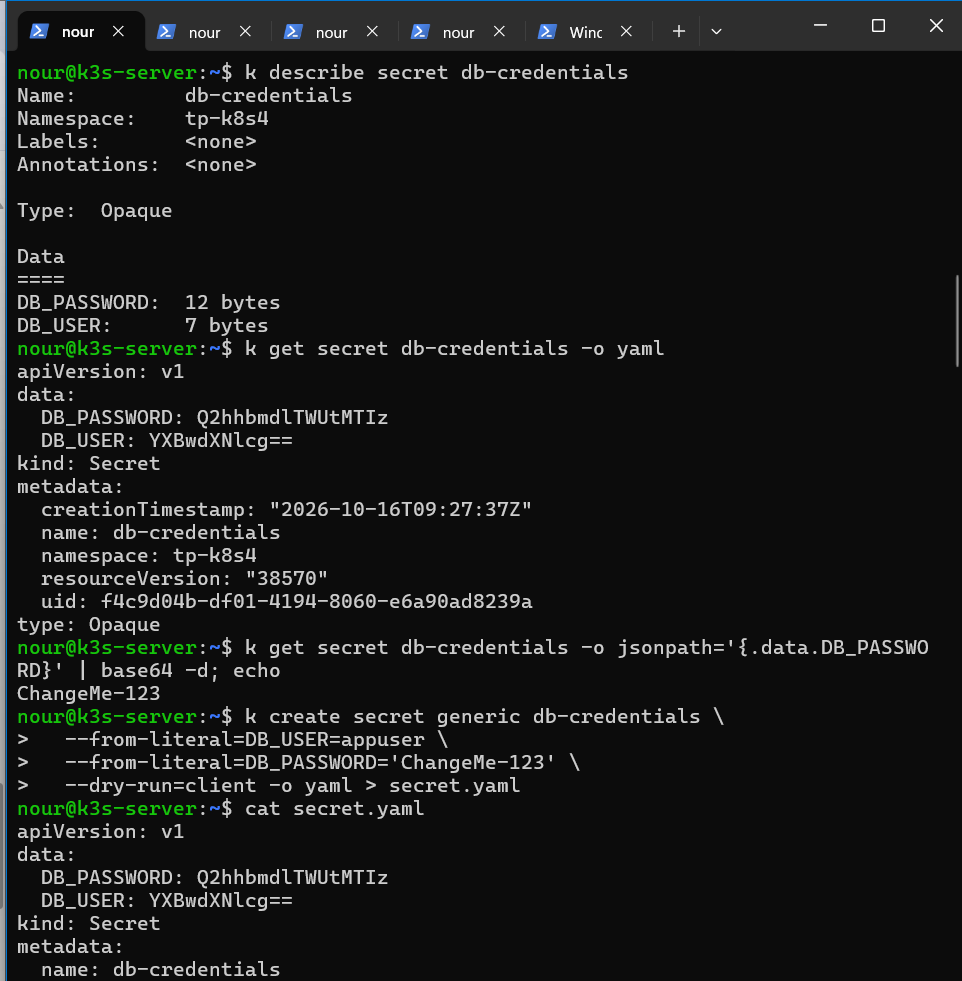

- `describe` n'affiche que la **taille** des valeurs (`DB_PASSWORD: 12 bytes`, `DB_USER: 7 bytes`), de type `Opaque`.
- Le YAML montre les valeurs encodées en base64 (`Q2hhbmdlTWUtMTIz`, `YXBwdXNlcg==`).
- `base64 -d` retrouve le mot de passe en clair : `ChangeMe-123`.
- Avec `--dry-run=client -o yaml`, le manifeste `secret.yaml` est généré sans rien créer dans le cluster. Ce fichier contient le vrai mot de passe, simplement encodé : il ne doit pas être versionné.

**Point de contrôle**

- [x] Le mot de passe a été décodé avec `base64 -d`
- [x] Encoder n'est pas chiffrer : n'importe qui peut décoder la valeur

### Étape 4 : Injecter la configuration dans un Deployment

```bash
k apply -f demo.yaml
k rollout status deployment/demo
k get pods
```

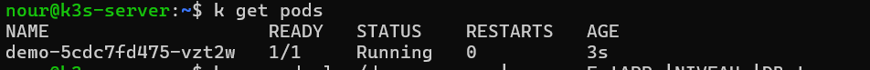

Le Pod `demo` est `Running` (`1/1`).

### Étape 5 : Vérifier l'injection

```bash
k exec deploy/demo -- env | grep -E 'APP_|NIVEAU_|DB_'
k exec deploy/demo -- ls /etc/app /etc/secret
k exec deploy/demo -- cat /etc/app/APP_COLOR
k exec deploy/demo -- cat /etc/secret/DB_PASSWORD; echo
```

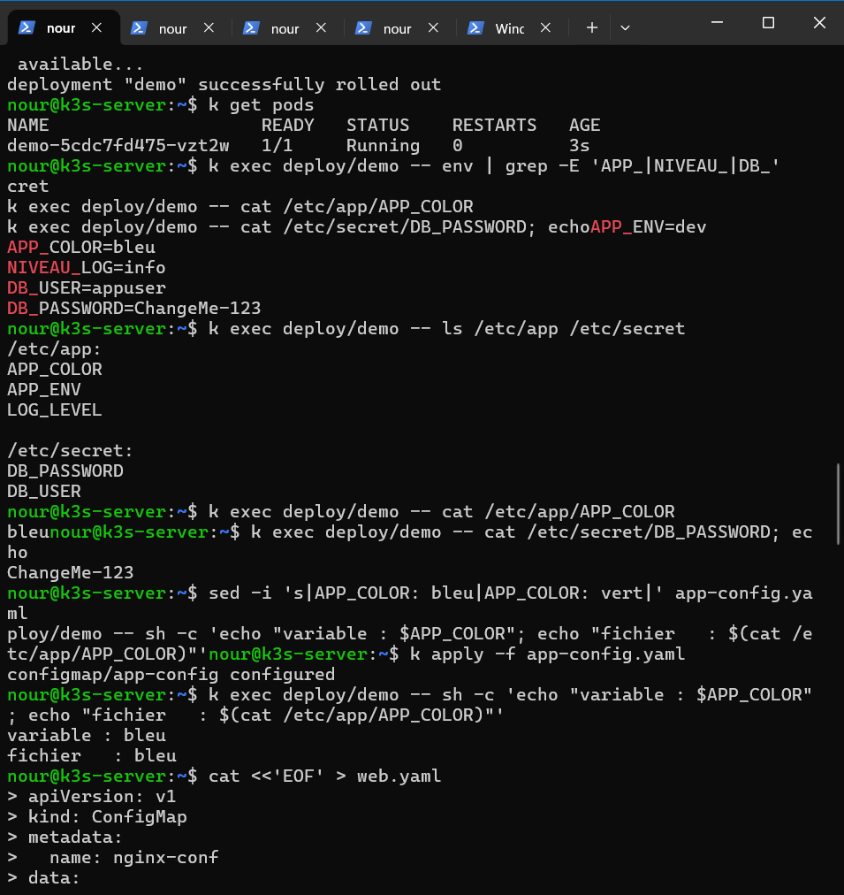

**Point de contrôle**

- [x] `APP_ENV=dev`, `APP_COLOR=bleu`, `NIVEAU_LOG=info`, `DB_USER=appuser` et `DB_PASSWORD` apparaissent dans l'environnement
- [x] `/etc/app` contient un fichier par clé du ConfigMap (`APP_COLOR`, `APP_ENV`, `LOG_LEVEL`) et `/etc/secret` un fichier par clé du Secret (`DB_PASSWORD`, `DB_USER`)

### Étape 6 : Modifier la configuration et observer

```bash
sed -i 's|APP_COLOR: bleu|APP_COLOR: vert|' app-config.yaml
k apply -f app-config.yaml
k exec deploy/demo -- sh -c 'echo "variable : $APP_COLOR"; echo "fichier   : $(cat /etc/app/APP_COLOR)"'
```

Le bas de la capture précédente montre le résultat immédiat après `apply` (`configmap/app-config configured`) : la variable **et** le fichier affichent encore `bleu`. Comme l'explique la question 1, le fichier monté en volume passe à `vert` après un délai d'un à deux minutes, alors que la variable reste à `bleu` tant que le Pod n'est pas relancé (`k rollout restart deployment/demo`). Ces deux observations ne sont pas incluses dans les captures.

### Étape 7 : Monter un fichier de configuration dans nginx

```bash
k apply -f web.yaml
k run test --rm -it --image=busybox:1.36 --restart=Never -- wget -qO- http://web-svc
sed -i 's|ConfigMap v1|ConfigMap v2|' web.yaml
k apply -f web.yaml
k exec deploy/web -- cat /etc/nginx/conf.d/default.conf
sleep 90
```

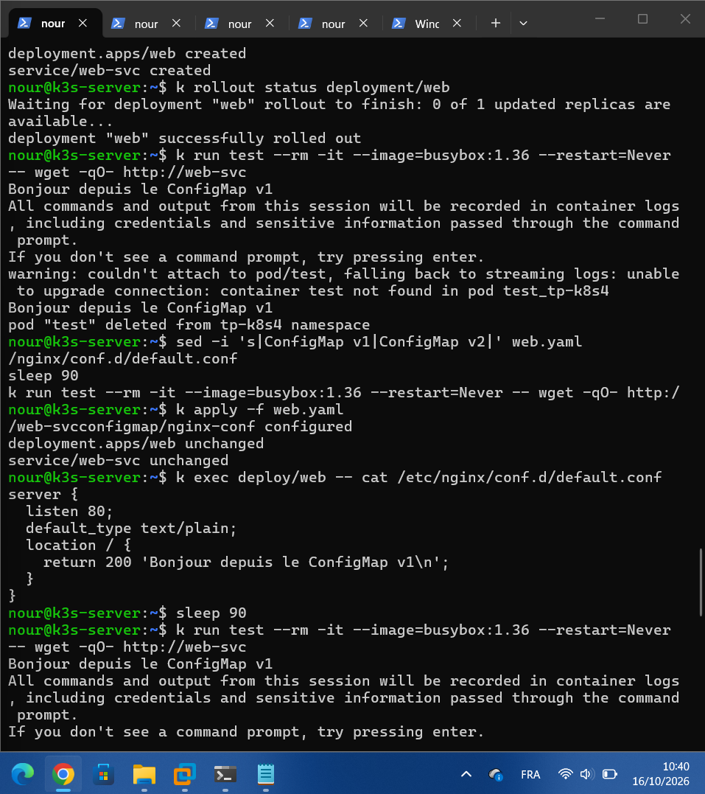

nginx répond `Bonjour depuis le ConfigMap v1` : la configuration vient bien du ConfigMap. Après le passage à `v2` (`configmap/nginx-conf configured`) et 90 secondes d'attente, le fichier dans le conteneur affiche **toujours `v1`**, et la réponse HTTP aussi : un montage avec `subPath` n'est pas rafraîchi.

```bash
k rollout restart deployment/web
k rollout status deployment/web
k run test --rm -it --image=busybox:1.36 --restart=Never -- wget -qO- http://web-svc
```

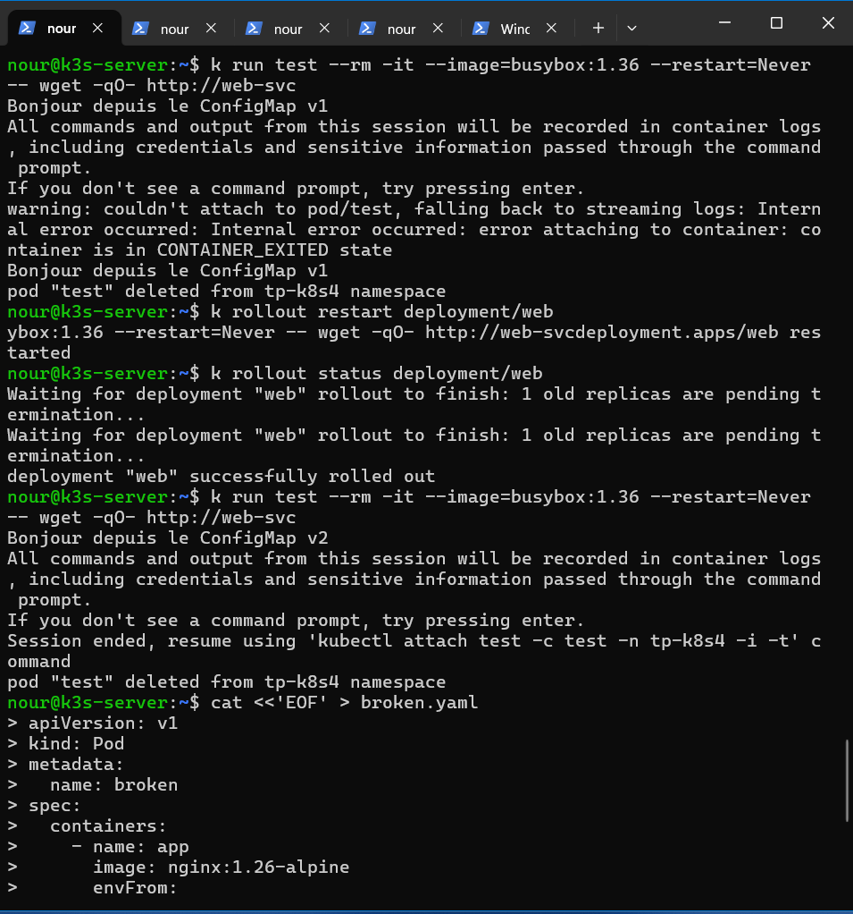

**Point de contrôle**

- [x] Avant le redémarrage, `cat` dans le conteneur affichait toujours la version `v1`
- [x] Après `rollout restart`, la réponse annonce `Bonjour depuis le ConfigMap v2`

### Étape 8 : Diagnostiquer une configuration manquante

```bash
k apply -f broken.yaml
k get pod broken
k describe pod broken | tail -n 8
k create configmap config-manquant --from-literal=EXEMPLE=1
k get pod broken -w
```

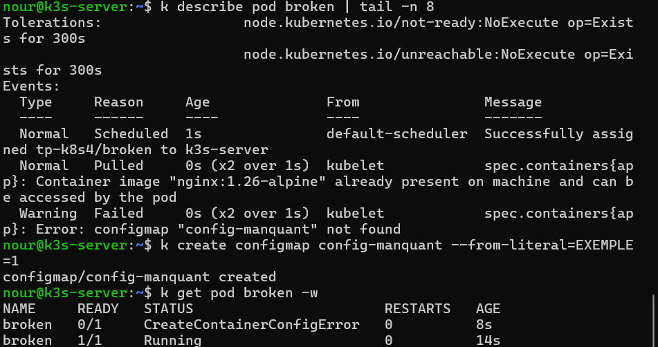

**Point de contrôle**

- [x] Les événements indiquent `Error: configmap "config-manquant" not found` (raison `Failed`, émise par le kubelet)
- [x] Après la création du ConfigMap, le Pod `broken` passe de `CreateContainerConfigError` à `Running` en 14 s, sans être recréé

### Questions de réflexion

**1. Pourquoi la variable `APP_COLOR` n'a-t-elle pas changé alors que le fichier `/etc/app/APP_COLOR` si ?**

Les variables d'environnement sont fixées au démarrage du conteneur. Un ConfigMap monté en volume est mis à jour par le kubelet après un délai. Il faut relancer les Pods pour renouveler les variables.

**2. Pourquoi le contenu servi par nginx est-il resté en v1 après la modification du ConfigMap ?**

Un montage avec `subPath` n'est pas rafraîchi automatiquement. Et même si le fichier changeait, nginx ne relirait pas sa configuration sans rechargement. Un `rollout restart` règle le problème.

**3. Quel est l'intérêt de `readOnly: true` sur le montage du Secret ?**

Il empêche le conteneur de modifier les fichiers du Secret : c'est une précaution de moindre privilège.

**4. Quelle différence entre `envFrom` et `configMapKeyRef` ?**

`envFrom` injecte toutes les clés du ConfigMap comme variables, avec leur nom. `configMapKeyRef` choisit une seule clé et permet de lui donner un autre nom de variable (ici `LOG_LEVEL` devient `NIVEAU_LOG`).

**5. Comment vérifier qu'aucun secret réel ne se trouve dans un dépôt Git ?**

En inspectant `git status` et le contenu des fichiers versionnés, en ajoutant les fichiers de Secret au `.gitignore`, et en ne gardant dans le dépôt qu'un fichier modèle avec de fausses valeurs.

---

## Lab 4.2 – Maîtriser les ressources

### Objectifs

- Lire la capacité d'un nœud et la consommation d'un Pod
- Définir des `requests` et des `limits`, et observer leurs effets
- Diagnostiquer un Pod `Pending` (ressources insuffisantes) et un `OOMKilled`
- Constater qu'une limite de CPU ralentit un conteneur
- Encadrer un namespace avec un `LimitRange` et un `ResourceQuota`

> **Remarques sur ce lab.** Il a été réalisé dans le namespace **`tp-k8s5`**. Comme `k top` répond `error: Metrics API not available` (le Pod `metrics-server` reste `0/1` malgré un redémarrage), les consommations ont été lues directement dans les fichiers **cgroup** du conteneur (`memory.current`, `cpu.max`, `cpu.stat`). Pour l'exercice OOM, l'image `busybox` a été remplacée par `polinux/stress`, et le **swap** du nœud a dû être désactivé (voir l'étape 4).

### Étape 1 : Lire la capacité du cluster

```bash
k describe node k3s-agent1 | grep -A8 "Allocated resources"
```

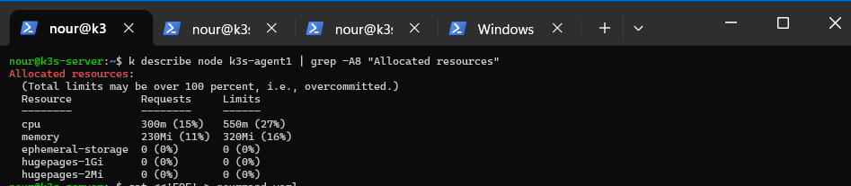

Sur `k3s-agent1`, les réservations cumulées (`Requests`) sont de `300m` de CPU (15 %) et `230Mi` de mémoire (11 %) ; les `Limits` de `550m` (27 %) et `320Mi` (16 %). La mention « Total limits may be over 100 percent, i.e., overcommitted » rappelle que les limites peuvent dépasser la capacité du nœud.

### Étape 2 : Déclarer des requests et des limits

```bash
k apply -f app.yaml
k get pods -o wide
k describe pod -l app=app | grep -A6 -E "Limits|Requests" | head -n 14
```

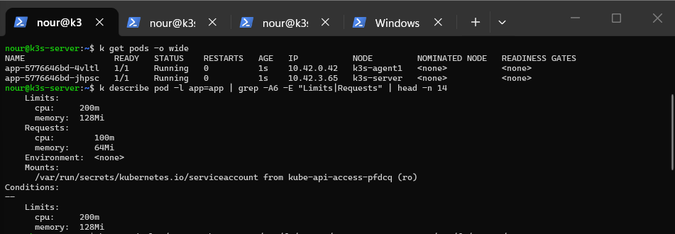

Les deux Pods `app` sont `Running` (sur `k3s-agent1` et `k3s-server`). `describe` affiche `Limits: cpu 200m, memory 128Mi` et `Requests: cpu 100m, memory 64Mi`.

`k top pods` n'étant pas disponible, la consommation réelle a été lue dans le conteneur :

```bash
k exec deploy/app -- sh -c 'cat /sys/fs/cgroup/memory.current; cat /sys/fs/cgroup/cpu.max'
```

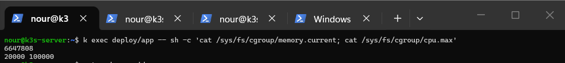

`memory.current` vaut `6647808` octets (environ 6,3 Mo), très en dessous de la réservation de 64 Mi. `cpu.max` vaut `20000 100000`, soit **200m** : le noyau applique bien la limite de CPU déclarée.

**Point de contrôle**

- [x] Les deux Pods sont `Running` et `describe` affiche les `requests` et `limits`
- [x] La consommation réelle est bien inférieure aux `requests`

### Étape 3 : Diagnostiquer un Pod Pending

```bash
k apply -f gourmand.yaml
k get pods -l app=gourmand
k describe pod -l app=gourmand | tail -n 6
```

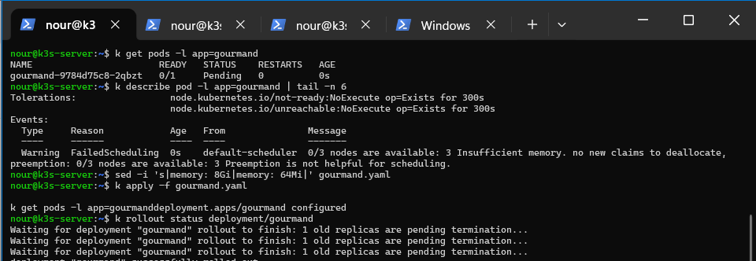

Le Pod reste `Pending`. L'événement `FailedScheduling` indique : `0/3 nodes are available: 3 Insufficient memory`. Après avoir remplacé `memory: 8Gi` par `memory: 64Mi` et réappliqué le fichier, le nouveau Pod démarre :

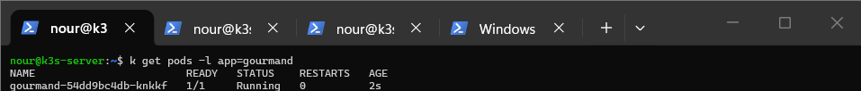

**Point de contrôle**

- [x] `Insufficient memory` lu dans les événements
- [x] Après correction, le Pod est `Running`

### Étape 4 : Provoquer un OOMKilled

Premier essai : le Pod `oom` (limite mémoire `50Mi`) est lancé, mais il reste `Running`.

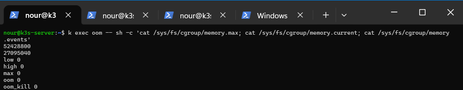


Le conteneur est limité à `memory.max = 52428800` (50 Mi) et sa mémoire courante monte à `51273728` octets, tout près de la limite, mais `oom_kill` reste à `0` : le conteneur n'est pas tué. Les VM ont du **swap** actif (2,9 Gi sur `k3s-server`) : le noyau peut alors déplacer des pages en swap au lieu de tuer le processus, ce qui explique l'absence d'OOM.

Le swap est donc désactivé (sur `k3s-server`), puis le Pod recréé, et cette fois il est tué :

```bash
free -h
swapon --show
sudo swapoff -a
sudo sed -i '/ swap / s/^/#/' /etc/fstab
k delete pod oom
k apply -f oom.yaml
k get pod oom -w
k describe pod oom | grep -A6 "Last State"
```


- `free -h` montre le swap avant (`2,9Gi`) et après (`0B`).
- Le Pod passe par `OOMKilled` puis `CrashLoopBackOff`.
- `describe` indique `Last State: Terminated`, `Reason: OOMKilled`, `Exit Code: 137`.
- `k logs oom` n'affiche que la ligne de démarrage de `stress` (`dispatching hogs`) : le conteneur est interrompu brutalement, la cause se lit dans `describe`, pas dans les logs.
- Dans la même capture, `k top nodes` répond `error: Metrics API not available`, y compris après un redémarrage du Deployment `metrics-server`.

**Point de contrôle**

- [x] `Last State` indique `OOMKilled` et le code de sortie `137`
- [x] Les logs ne montrent pas la cause : c'est `describe` qui l'indique

### Étape 5 : Observer la limite de CPU

```bash
k apply -f cpu.yaml
for p in cpu-libre cpu-limite; do echo "== $p"; k exec $p -- cat /sys/fs/cgroup/cpu.stat | grep -E "usage_usec|nr_throttled|throttled_usec"; done
```


Deux mesures successives, à environ dix secondes d'écart :

| Pod | `usage_usec` (1ʳᵉ mesure → 2ᵉ mesure) | `nr_throttled` | `throttled_usec` |
|---|---|---|---|
| `cpu-libre` (sans limite) | 66 836 854 → 79 262 979 | 0 → 6 | 0 |
| `cpu-limite` (`cpu: 100m`) | 6 356 473 → 7 628 881 | 816 → 943 | 75 552 999 → 87 091 338 |

Entre les deux mesures, `cpu-libre` consomme environ **dix fois plus** de temps CPU que `cpu-limite` (+12,4 s contre +1,3 s). `cpu-limite` est ralenti en permanence par le noyau (`nr_throttled` augmente de 816 à 943) mais n'est pas arrêté. Les deux Pods sont ensuite supprimés (`k delete -f cpu.yaml`).

**Point de contrôle**

- [x] `cpu-limite` reste `Running` mais est limité à environ 100m
- [x] `cpu-libre` consomme nettement plus
- [x] Les deux Pods de test sont supprimés

### Étape 6 : Poser un ResourceQuota, puis un LimitRange

```bash
k create namespace tp-quota
k apply -f quota.yaml
k run test --image=nginx:1.26-alpine
k apply -f limitrange.yaml
k run test --image=nginx:1.26-alpine
k get pod test -o jsonpath='{.spec.containers[0].resources}'; echo
k describe quota quota
```


**Point de contrôle**

- [x] Avant le `LimitRange`, la création est refusée : `must specify limits.cpu ... limits.memory ... requests.cpu ... requests.memory`
- [x] Après le `LimitRange`, le Pod `test` reçoit automatiquement `requests: cpu 50m, memory 64Mi` et `limits: cpu 200m, memory 128Mi`
- [x] `describe quota` affiche la consommation du Pod : `pods 1/5`, `requests.cpu 50m/500m`, `requests.memory 64Mi/512Mi`, `limits.cpu 200m/2`, `limits.memory 128Mi/1Gi`

### Étape 7 : Dépasser le quota

```bash
k create deployment charge --image=nginx:1.26-alpine --replicas=8
k describe quota quota
k describe replicaset -l app=charge | tail -n 8
k apply -f gros.yaml
k scale deployment charge --replicas=2
```

La capture de l'étape précédente (bas de l'image) montre `charge` bloqué à `4/8` après 10 secondes. La capture suivante montre la suite :


- Le quota est saturé : `pods 5/5`.
- Les événements du ReplicaSet répètent `FailedCreate ... exceeded quota: quota, requested: pods=1, used: pods=5, limited: pods=5`.
- Le Pod `gros` (600m de CPU) est refusé immédiatement par `Forbidden: exceeded quota`, car `requests.cpu` dépasserait la limite de `500m`.
- Après `k scale deployment charge --replicas=2`, il reste 3 Pods (`charge` ×2 et `test`) et `describe quota` indique `pods 3/5` : la consommation est revenue sous la limite.

**Point de contrôle**

- [x] Le Deployment `charge` n'a jamais atteint 8 Pods, avec `exceeded quota` dans les événements du ReplicaSet
- [x] Le Pod `gros` a été refusé à la création
- [x] Après la réduction, `Used` est revenu sous `Hard`

### Questions de réflexion

**1. Pourquoi un Pod avec `requests: memory: 8Gi` reste-t-il `Pending` alors que le conteneur ne consommerait pas autant ?**

Le scheduler se base sur les `requests` (la réservation), pas sur la consommation réelle. Aucun nœud n'a 8 Gi de mémoire non réservée, donc le Pod n'est placé nulle part (`0/3 nodes are available: 3 Insufficient memory`).

**2. Quelle différence de comportement entre le dépassement d'une limite de CPU et celui d'une limite de mémoire ?**

Le CPU est « compressible » : le conteneur est ralenti (`nr_throttled` augmente) mais continue de tourner. La mémoire ne l'est pas : le conteneur est tué (`OOMKilled`, code 137) puis redémarré.

**3. Où lire la cause d'un `OOMKilled` ?**

Dans `kubectl describe pod`, section `Last State` : motif `OOMKilled` et code de sortie 137. Les logs ne le montrent pas, puisque le conteneur est interrompu brutalement.

**4. Pourquoi le Pod `test` a-t-il été refusé avant l'ajout du LimitRange ?**

Le quota porte sur le CPU et la mémoire : chaque Pod doit donc déclarer ses `requests` et `limits`. Le `LimitRange` fournit des valeurs par défaut quand elles sont absentes.

**5. Pourquoi le Deployment `charge` a-t-il été accepté alors que ses Pods ne le sont pas ?**

Le Deployment ne crée pas les Pods lui-même : c'est son ReplicaSet qui le fait. Le quota refuse la création des Pods, d'où l'erreur dans les événements du ReplicaSet et non au moment du `apply`.

---

## Lab 5.1 – Volumes persistants

### Objectifs

- Constater la perte de données d'un conteneur et d'un `emptyDir`
- Créer un PVC et observer sa liaison avec un PV (provisionnement dynamique)
- Repérer où les données sont stockées avec `local-path`
- Observer la suppression d'un PVC et diagnostiquer un PVC bloqué en `Pending`

### Étape 1 : Examiner la StorageClass

```bash
k get storageclass
k get storageclass local-path -o yaml | grep -E "reclaimPolicy|volumeBindingMode|is-default-class"
```


**Point de contrôle**

- [x] `local-path` est la classe par défaut (`is-default-class: "true"`), fournie par `rancher.io/local-path`
- [x] `reclaimPolicy: Delete` et `volumeBindingMode: WaitForFirstConsumer`

### Étape 2 : Perte de données avec emptyDir

```bash
k exec temp -- sh -c 'echo "dans emptyDir" > /donnees/fichier.txt; echo "dans le conteneur" > /tmp/ephemere.txt'
k exec temp -- nginx -s stop
k get pod temp
k exec temp -- ls /donnees /tmp
k delete pod temp
k apply -f temp.yaml
k exec temp -- ls /donnees
```


**Point de contrôle**

- [x] Avant l'arrêt de nginx, `/donnees` contient `fichier.txt` et `/tmp` contient `ephemere.txt`
- [x] Après le redémarrage du conteneur (`RESTARTS 1`), `fichier.txt` existe toujours et `/tmp` est vide : `ephemere.txt` a disparu
- [x] Après la suppression et la recréation du Pod, `/donnees` est vide

### Étape 3 : Créer un PVC

```bash
k apply -f pvc.yaml
k get pvc,pv
k describe pvc data | tail -n 5
```


**Point de contrôle**

- [x] `k get pvc` affiche `Pending` pour le PVC `data`
- [x] `describe` indique `WaitForFirstConsumer` : le PVC attend un premier Pod qui l'utilise avant d'être lié

Le PV listé dans la capture (`tasks/data-db-0`) appartient à un autre namespace (`tasks`), pas à ce lab.

### Étape 4 : Utiliser le PVC dans un Pod

```bash
k apply -f app.yaml
k get pvc,pv
k get pod app -o wide
PV=$(k get pvc data -o jsonpath='{.spec.volumeName}')
k describe pv $PV | grep -E -A6 "Node Affinity|Source"
k exec app -- sh -c 'echo "Bonjour, donnee persistante" > /usr/share/nginx/html/index.html'
k exec app -- wget -qO- http://localhost
```


**Point de contrôle**

- [x] Le PVC `data` est `Bound` à un PV créé automatiquement (`pvc-52fbe783-...`, 1 Gi, `RWO`, `Delete`)
- [x] Le Pod `app` s'exécute sur `k3s-agent2`, et le PV porte une affinité vers ce nœud (`kubernetes.io/hostname in [k3s-agent2]`)
- [x] Le volume est un `LocalVolume` stocké dans `/var/lib/rancher/k3s/storage/pvc-52fbe783-..._tp-k8s_data`
- [x] nginx sert la page écrite dans le volume : `Bonjour, donnee persistante`

### Étape 6 : Supprimer le PVC

```bash
k delete pvc data --wait=false
k get pvc
k delete pod app
k get pvc,pv
k apply -f pvc.yaml
k apply -f app.yaml
k exec app -- ls /usr/share/nginx/html
```


**Point de contrôle**

- [x] Le PVC reste `Terminating` tant que le Pod `app` l'utilise
- [x] Après la suppression du Pod, le PVC et son PV ont disparu (seul le PV `tasks/data-db-0`, d'un autre namespace, subsiste)
- [x] Après la recréation du PVC et du Pod, `ls /usr/share/nginx/html` ne renvoie rien : le volume est vide, la page précédente est perdue

### Étape 7 : Diagnostiquer un PVC en Pending

```bash
k apply -f pvc-erreur.yaml
k describe pvc data-erreur | tail -n 5
k delete pvc data-erreur
sed -i 's|local-pat$|local-path|' pvc-erreur.yaml
k apply -f pvc-erreur.yaml
k get pvc data-erreur
```


**Point de contrôle**

- [x] Les événements indiquent `ProvisioningFailed : storageclass.storage.k8s.io "local-pat" not found`
- [x] Après correction (`local-path`), le PVC est `Pending` sans erreur : il attend simplement un Pod

### Questions de réflexion

**1. Pourquoi le fichier de l'`emptyDir` a-t-il survécu au redémarrage du conteneur mais pas à la suppression du Pod ?**

Un `emptyDir` appartient au Pod, pas au conteneur : il est créé avec le Pod et supprimé avec lui. Un redémarrage de conteneur garde le même Pod, donc le même volume. Le système de fichiers du conteneur, lui, est recréé (`ephemere.txt` a disparu).

**2. Pourquoi le Pod recréé a-t-il été placé sur le même nœud ?**

Avec `local-path`, les données sont un simple dossier sur le disque d'un nœud, et le PV porte une affinité vers ce nœud (ici `k3s-agent2`). Le scheduler doit donc replacer le Pod là où se trouvent les données.

**3. Que se passerait-il pour l'application si le nœud hébergeant le volume tombait en panne ?**

Les données deviendraient inaccessibles et le Pod ne pourrait pas démarrer ailleurs : il resterait `Pending` jusqu'au retour du nœud. `local-path` ne réplique rien entre les nœuds.

**4. Pourquoi le PVC est-il resté en `Terminating` tant que le Pod existait ?**

Kubernetes protège un PVC utilisé par un Pod : sa suppression n'est effective qu'une fois le Pod supprimé. Cela évite de retirer le stockage sous les pieds d'une application en cours d'exécution.

**5. Quelle précaution prendre avant de supprimer un PVC dont la rétention est `Delete` ?**

Vérifier qu'aucune donnée utile n'y est stockée, ou en faire une copie avant : avec `Delete`, le PV et les données sont supprimés avec le PVC, comme on l'a vu (le volume recréé était vide). Pour des données importantes, on peut choisir la politique `Retain`.

---

## Lab 5.2 – Base de données avec StatefulSet

### Objectifs

- Déployer PostgreSQL avec un StatefulSet, un Service headless et un volume par Pod
- Injecter la configuration avec un ConfigMap et un Secret
- Démontrer que les données survivent à la suppression du Pod
- Observer les noms DNS d'un Service headless
- Constater que deux réplicas d'un StatefulSet ne partagent pas leurs données

### Étape 1 : Préparer la configuration

```bash
k apply -f app-config.yaml
k create secret generic db-credentials --from-literal=POSTGRES_USER=appuser --from-literal=POSTGRES_PASSWORD='ChangeMe-123'
k get configmap,secret
```


Le ConfigMap `app-config` (3 clés) et le Secret `db-credentials` (type `Opaque`, 2 clés) existent.

### Étape 2 : Déployer la base avec un StatefulSet

```bash
k apply -f db.yaml
k get statefulset,service,pvc,pv
k logs db-0 | tail -n 5
k exec db-0 -- pg_isready -U appuser -d appdb
```


**Point de contrôle**

- [x] Le StatefulSet `db` est à `1/1` et le Pod s'appelle `db-0`
- [x] Le Service `db` est **headless** : `CLUSTER-IP None`, port `5432`
- [x] Le PVC `data-db-0` est `Bound` à un PV (1 Gi, `RWO`, `local-path`)
- [x] Les logs indiquent `database system is ready to accept connections`
- [x] `pg_isready` répond `accepting connections`

### Étape 3 : Créer des données

```bash
k exec db-0 -- psql -U appuser -d appdb -c "INSERT INTO taches (titre) VALUES ('Apprendre les StatefulSets'), ('Tester la persistance');"
k exec db-0 -- psql -U appuser -d appdb -c "SELECT * FROM taches;"
```


`INSERT 0 2` puis `SELECT` renvoient deux lignes : `Apprendre les StatefulSets` et `Tester la persistance`.

### Étape 4 : Prouver la persistance

```bash
k get pod db-0 -o wide
k delete pod db-0
k get pods -w
```

Avant la suppression, `db-0` tourne depuis 7 min 42 s sur `k3s-agent2` (IP `10.42.4.51`) :


Après la suppression et la recréation :

```bash
k exec db-0 -- pg_isready -U appuser -d appdb
k exec db-0 -- psql -U appuser -d appdb -c "SELECT * FROM taches;"
k get pod db-0 -o wide
k get pvc
```


**Point de contrôle**

- [x] Le Pod recréé porte le même nom `db-0` (âgé de 62 s, nouvelle IP `10.42.4.52`)
- [x] Les deux lignes de la table `taches` sont toujours présentes
- [x] Il s'exécute sur le même nœud (`k3s-agent2`), avec le même PVC `data-db-0` (`Bound`)

### Étape 5 : Joindre la base par son nom DNS

```bash
k run test --rm -it --image=busybox:1.36 --restart=Never -- nslookup db-0.db
k run test --rm -it --image=busybox:1.36 --restart=Never -- nslookup db-0.db.tp-k8s.svc.cluster.local
```


Le nom court `db-0.db` n'est pas résolu par l'outil `nslookup` de `busybox` (`NXDOMAIN`). Le **nom complet** `db-0.db.tp-k8s.svc.cluster.local` est résolu en `10.42.4.52`, l'adresse du Pod `db-0` : avec un Service headless, le DNS renvoie directement l'adresse du Pod, sans adresse de Service virtuelle.

### Étape 6 : Passer à deux réplicas

```bash
k scale statefulset db --replicas=2
k get pods -w
k get pvc
k exec db-1 -- psql -U appuser -d appdb -c "\dt"
k exec db-0 -- psql -U appuser -d appdb -c "\dt"
```


**Point de contrôle**

- [x] `db-1` est créé après que `db-0` est `Running` (`Pending`, `ContainerCreating`, puis `Running`)
- [x] `db-1` a son propre PVC, `data-db-1` (`Bound`), distinct de `data-db-0`
- [x] `db-1` répond `Did not find any relations` : la table `taches` n'y existe pas, alors que `db-0` la contient

### Étape 7 : Comprendre le rôle du mot de passe initial

```bash
k exec db-0 -- pg_isready -U appuser -d appdb
k exec db-0 -- psql -U appuser -d appdb -c "SELECT * FROM taches;"
k run client-old --rm -it --image=postgres:16-alpine --restart=Never --env="PGPASSWORD=ChangeMe-123" -- psql -h db -U appuser -d appdb -c "SELECT 1;"
```


Après le changement du Secret et le redémarrage du StatefulSet, `db-0` accepte les connexions et ses deux lignes sont intactes. Le client utilisant l'**ancien** mot de passe `ChangeMe-123` se connecte (`SELECT 1` renvoie `1`) : modifier le Secret ne change pas le mot de passe enregistré dans la base. La capture se termine par `k delete namespace tp-k8s` (nettoyage).

### Questions de réflexion

**1. Pourquoi le Pod recréé s'appelle-t-il encore `db-0` et retrouve-t-il ses données ?**

Un StatefulSet donne à ses Pods une identité stable (nom et volume associé). Quand `db-0` est supprimé, un Pod de même nom est créé et rattaché au même PVC `data-db-0`.

**2. Quelle est la particularité d'un Service headless et pourquoi la préfère-t-on pour un StatefulSet ?**

Il n'a pas d'adresse virtuelle : le DNS renvoie directement les adresses des Pods, et chaque Pod a un nom DNS stable (`db-0.db...`). C'est utile quand on doit distinguer les membres d'un groupe, par exemple une base répliquée.

**3. Pourquoi la table `taches` n'existait-elle pas dans `db-1` ?**

Un StatefulSet ne réplique pas les données : chaque Pod a son propre volume et sa propre base. La réplication doit être configurée dans la base elle-même.

**4. Pourquoi le PVC `data-db-1` a-t-il subsisté après la réduction à un réplica ?**

Kubernetes ne supprime pas automatiquement les PVC d'un StatefulSet, pour éviter de détruire des données par erreur. Il faut les supprimer explicitement.

**5. Pourquoi le changement du mot de passe dans le Secret n'a-t-il pas modifié le mot de passe de la base ?**

`POSTGRES_PASSWORD` n'est utilisée qu'à la création de la base, sur un volume vide. Une fois la base initialisée, le mot de passe est conservé dans ses données ; il faut le modifier avec une commande SQL.

---

## Lab 6.1 – Jobs et CronJobs

### Objectifs

- Exécuter une tâche ponctuelle avec un Job et lire ses résultats
- Observer les nouvelles tentatives, l'échec et le nettoyage automatique d'un Job
- Paralléliser un Job avec `completions` et `parallelism`
- Planifier une tâche avec un CronJob, la déclencher à la main, la suspendre
- Écrire une sauvegarde planifiée sur un volume persistant

### Étape 2 : Un Job simple

```bash
k apply -f calcul.yaml
k wait --for=condition=complete job/calcul --timeout=60s
k get job,pods
k logs job/calcul
k describe job calcul | grep -E "Pods Statuses|Completions"
```


**Point de contrôle**

- [x] Le Job `calcul` affiche `COMPLETIONS 1/1` (durée 10 s)
- [x] Le Pod `calcul-l7pqw` est `Completed`, sans redémarrage
- [x] `k logs` affiche `debut` puis `fin`

`describe` confirme `Pods Statuses: 0 Active / 1 Succeeded / 0 Failed`.

### Étape 3 : Un Job en échec

```bash
k apply -f echec.yaml
k get pods -l job-name=echec -w
k get job echec
k describe job echec | tail -n 8
```


Avec `restartPolicy: Never`, le premier Pod `echec-hs9fr` passe en `Error` après 3 s. Le Job (`Running 0/1`) crée ensuite un **nouveau Pod** distinct, `echec-8jhqz` (événements `SuccessfulCreate`, à 5 s d'écart sur la capture) : chaque tentative a son propre Pod. Le Job finit à l'état `Failed 0/1` (visible à l'étape 6) lorsque `backoffLimit` est dépassé.

Comparaison avec `restartPolicy: OnFailure` :

```bash
sed -e 's/name: echec/name: echec-onfailure/' -e 's/restartPolicy: Never/restartPolicy: OnFailure/' echec.yaml | k apply -f -
sleep 40
k get pods -l job-name=echec-onfailure
```


Après 40 s, `No resources found` : avec `backoffLimit: 2`, le Job `echec-onfailure` a déjà dépassé sa limite. Il est `Failed` (visible à l'étape 6) et Kubernetes a supprimé son Pod. Avec `OnFailure`, les tentatives se font dans le **même Pod** (colonne `RESTARTS` qui augmente), alors qu'avec `Never` chaque tentative crée un Pod.

### Étape 4 : Un Job parallèle avec nettoyage automatique

```bash
k apply -f parallele.yaml
k get job parallele -w
```


**Point de contrôle**

- [x] Le Job progresse par paires : `0/6`, puis `2/6`, `4/6`, et enfin `Complete 6/6` en 40 s
- [x] Au plus 2 Pods tournaient en même temps (`parallelism: 2`)

### Étapes 5 et 6 : CronJob, concurrence et suspension

```bash
k describe cronjob lent | tail -n 6
k patch cronjob sauvegarde -p '{"spec":{"suspend":true}}'
k get cronjob
k get jobs
sleep 90
k get jobs
k patch cronjob sauvegarde -p '{"spec":{"suspend":false}}'
k get cronjob
```


**Concurrence (`concurrencyPolicy: Forbid`)**

- [x] Un seul Job `lent-29869720` est actif (`Running 0/1`, 2 min 15 s), malgré les échéances toutes les minutes
- [x] Les événements du CronJob affichent `JobAlreadyActive : Not starting job because prior execution is running and concurrency policy is Forbid`

**Suspension**

- [x] Après `suspend: true`, `k get cronjob` affiche `SUSPEND True`
- [x] La liste des Jobs ne change pas pendant les 90 s d'attente : `sauvegarde-29869720`, `-29869721` et `-29869722` sont toujours les seuls Jobs de sauvegarde
- [x] Après `suspend: false`, `k get cronjob` affiche `SUSPEND False`

La liste des Jobs ne contient plus `parallele` : il a été supprimé automatiquement par `ttlSecondsAfterFinished: 120`. Elle montre aussi `calcul` (`Complete`), `echec` et `echec-onfailure` (`Failed`).

### Étape 7 : Sauvegarde sur un volume persistant

```bash
k apply -f sauvegarde-vol.yaml
k get pvc
k apply -f lecteur.yaml
k exec lecteur -- ls -l /backup
```


Le PVC `backup-pvc` est `Pending` juste après sa création (comportement normal de `local-path` avant le premier consommateur), et le Pod `lecteur` démarre. Sur cette capture, prise quelques secondes après la création du CronJob, le dossier `/backup` est encore vide (`total 0`) : la première exécution du CronJob n'avait pas encore eu lieu.

### Questions de réflexion

**1. Quelle différence de comportement entre `restartPolicy: Never` et `OnFailure` pour un Job qui échoue ?**

Avec `Never`, chaque tentative crée un nouveau Pod (les Pods en erreur restent visibles). Avec `OnFailure`, le conteneur est relancé dans le même Pod (la colonne `RESTARTS` augmente).

**2. À quoi sert `ttlSecondsAfterFinished` ?**

À supprimer automatiquement un Job terminé et ses Pods après un délai. Sans lui, les Jobs et leurs Pods s'accumulent dans le namespace. Ici, `parallele` a disparu seul 2 minutes après sa fin.

**3. Que se passerait-il avec `concurrencyPolicy: Allow` à l'étape 6 ?**

Une nouvelle exécution démarrerait à chaque minute sans attendre la fin de la précédente : plusieurs Jobs `lent-...` tourneraient en parallèle, ce qui est dangereux pour une sauvegarde.

**4. Pourquoi `kubectl create job --from=cronjob/...` est-il utile ?**

Il permet de tester immédiatement le contenu du CronJob (commande, volumes, variables) sans attendre l'échéance du calendrier.

**5. Une sauvegarde stockée sur le même volume local que la base protège-t-elle contre la perte d'un nœud ? Que proposer ?**

Non : si le nœud tombe, la base et sa sauvegarde disparaissent ensemble. Il faut copier les sauvegardes ailleurs : stockage réseau, autre nœud, stockage objet ou machine distante.

---

## Lab 6.2 – Patterns multi-conteneurs

### Objectifs

- Utiliser des init containers pour attendre une dépendance et préparer des fichiers
- Diagnostiquer un init container en échec
- Partager un volume et le réseau entre les conteneurs d'un Pod (sidecar)
- Mettre en place un conteneur ambassador qui sert de proxy vers un Service
- Cibler un conteneur précis avec `-c` dans `logs` et `exec`

### Étape 2 : Init containers

Le Pod `appli` démarre deux init containers dans l'ordre : `attendre-backend` boucle tant que le Service `backend` n'est pas joignable, puis `preparer-contenu` écrit une page dans un volume partagé avec le conteneur nginx. Le Service `backend` n'existe pas encore : l'initialisation reste bloquée.

```bash
k apply -f appli.yaml
sleep 15
k get pods
k logs deploy/appli -c attendre-backend --tail=3
```


**Point de contrôle**

- [x] Tant que le backend n'existe pas, le Pod `appli-6896f9c74f-kqrvj` reste en `Init:0/2` (`READY 0/1`, 0 redémarrage)
- [x] Les logs de `attendre-backend` montrent les tentatives : `attente du backend`, puis `wget: bad address 'backend'` (le nom du Service ne se résout pas encore)

Le Service `backend` est ensuite créé (`k apply -f backend.yaml`) : le Pod passe alors par `Init:1/2`, `PodInitializing`, puis `Running`, et nginx sert la page écrite par `preparer-contenu`.

### Étape 3 : Diagnostiquer un init container en échec

```bash
k apply -f init-erreur.yaml
sleep 30
k get pod init-erreur
k logs init-erreur -c init-casse
k describe pod init-erreur | grep -A8 "Init Containers"
k delete pod init-erreur
```


**Point de contrôle**

- [x] Le statut du Pod commence par `Init:` : ici `Init:Error`, avec `READY 0/1` et 2 redémarrages en 32 s (les conteneurs de l'application ne démarrent pas)
- [x] Les logs de l'init container `init-casse` affichent `preparation en cours`
- [x] `describe` détaille l'init container `init-casse` (image `busybox:1.36`, commande `sh -c "echo preparation en cours; exit 1"`)

Le statut passe ensuite par `Init:CrashLoopBackOff`, avec des redémarrages de plus en plus espacés.

### Étape 4 : Sidecar, volume partagé et réseau partagé

```bash
k apply -f app-logs.yaml
k wait --for=condition=Ready pod/app-logs --timeout=60s
sleep 15
k get pod app-logs
k logs app-logs -c app
k logs app-logs -c lecteur-logs --tail=3
k exec app-logs -c app -- ls -l /logs
```


**Point de contrôle**

- [x] Le Pod `app-logs` est `Running` avec `READY 2/2` (deux conteneurs)
- [x] `k logs app-logs -c app` est **vide** (l'application écrit dans un fichier, pas sur sa sortie standard), alors que `k logs app-logs -c lecteur-logs` affiche des dates (`Sat Oct 17 19:20:50`, `19:20:55`, `19:21:00 UTC 2026`)
- [x] Le fichier `/logs/app.log` (870 octets) est visible depuis le conteneur `app`

### Étape 5 : Ambassador

L'application appelle uniquement `localhost:8080` ; un conteneur nginx (`proxy`) joue le rôle de proxy vers le Service `backend`.

```bash
k apply -f ambassador.yaml
k wait --for=condition=Ready pod/ambassador --timeout=60s
k logs ambassador -c app --tail=3
k scale deployment backend --replicas=0
k logs ambassador -c app --tail=3
k scale deployment backend --replicas=1
k rollout status deployment/backend
k logs ambassador -c app --tail=3
```


**Point de contrôle**

- [x] L'application obtient la page du backend (`<title>Welcome to nginx!</title>`) en appelant seulement `localhost:8080`
- [x] Avec le backend à 0 réplica, les logs montrent `wget: server returned error: HTTP/1.1 502 Bad Gateway` : le proxy répond, mais n'a plus de backend à joindre
- [x] Après `k scale deployment backend --replicas=1` et la fin du rollout, l'application obtient de nouveau la page, sans que le Pod `ambassador` ait été modifié ou recréé

La capture se termine par `k delete namespace tp-k8s` (nettoyage).

### Questions de réflexion

**1. Pourquoi un init container est-il préférable à une boucle d'attente écrite dans l'application ?**

Il sépare la préparation de l'application, qui reste simple, et garantit que les conteneurs applicatifs ne démarrent qu'une fois la dépendance disponible. Il se diagnostique à part, avec `logs -c`.

**2. Que se passe-t-il si un init container échoue de façon répétée ?**

Les conteneurs de l'application ne démarrent pas. Le Pod reste en `Init:Error` puis `Init:CrashLoopBackOff`, avec des redémarrages de plus en plus espacés.

**3. Pourquoi les logs du conteneur `app` de l'étape 4 sont-ils vides alors que l'application fonctionne ?**

Elle écrit dans un fichier et non sur la sortie standard, seule source de `kubectl logs`. Le sidecar relit le fichier et l'affiche sur sa propre sortie standard.

**4. Qu'est-ce qui permet à `testeur` d'appeler nginx avec `localhost` ?**

Les conteneurs d'un même Pod partagent la même interface réseau et la même adresse IP : `localhost` désigne donc le même Pod pour tous ses conteneurs.

**5. Quel intérêt d'un ambassador pour l'application ?**

Elle appelle toujours `localhost`, quelle que soit la destination réelle. Le proxy peut changer d'adresse, ajouter de la sécurité ou de la reprise sur erreur sans toucher au code de l'application.

---

### Nettoyage (valable pour tous les labs)

Pour chaque lab, le nettoyage consiste à supprimer le namespace de travail (`k delete namespace <nom>`) puis à remettre le contexte sur `default` :

```bash
k config set-context --current --namespace=default
k get pv
```
